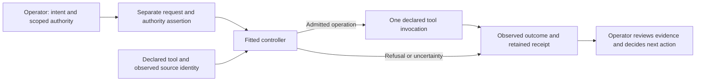

# Tool instrumentation architecture

Instrumentation starts with **one declared tool and one repeatable operation**. The operator inspects the tool's actual inputs, writes, failure states, and evidence before deciding whether a controller is justified. The controller handles the mechanical steps that can be bounded for that tool. The operator remains responsible for intent, authorization, acceptance, and recovery decisions.

The [instrumentation method](README.md) is the entry point. This page maps the pieces of the fitted examples; it does not define a universal controller protocol.

## Boundaries at each handoff

| Part | Responsibility | Boundary |
| --- | --- | --- |
| **Declared tool** | Supplies the actual operation, state transition, and evidence conditions. | The controller does not expand its interface or replace its acceptance rules. |
| **Request** | Describes one operation and its inputs using the selected controller's contract. | A well-formed request does not grant authority. |
| **Authority assertion** | Binds the request digest to the observed source identity and permitted target or output root. For evidence-bearing gate results, it also binds the existing evidence file's digest. | A digest identifies what was bound. It does not establish that a person was authorized to make the assertion or that the evidence is true. |
| **Fitted controller** | Applies its own preflight, path and identity checks, leases where applicable, and process handling. It retains what it observed. | These are controller-specific checks, not a generic writer policy or protection from direct or noncooperating tool invocation. |
| **Receipt** | Separates admission, process outcome, the tool's reported result, any structural check, and retained or uncertain state. | A reported success is not necessarily a verified artifact, semantic acceptance, or permission to take the next action. |

Controller state is kept outside the tool source tree. If the receipt says `partial_or_unknown`, stop and preserve the receipt and affected state. Do not infer permission to rerun or repair from uncertainty. Review the [existing-controller how-to](HOW_TO_USE.md) for the receipt fields and the operator's next decision.

## Three fitted Mill examples

| Example | Declared operation | Retained evidence boundary |
| --- | --- | --- |
| [Creation](mill-controllers/creation/README.md) | Create one non-overwriting `HOLD` batch through `New-MillBatch.ps1`. | Basic checks, deterministic hardening, seeded admission cases, and contention evidence. Direct Mill invocation is outside the controller lease. |
| [Verification](mill-controllers/verification/README.md) | Inspect one batch through `Test-MillBatch.ps1`. | Structural checks, hardening, contention evidence, and a bounded comparison. A structural pass is not proof of the batch's claims. |
| [Gate recording](mill-controllers/gate/README.md) | Record one gate result through `Set-MillGate.ps1`, with evidence binding where required. | Basic integration cases and subsequent structural checks on selected resulting batches. The validation record does not claim the creation/verification hardening or comparison for this controller. |

The [ES-xOSG-0 example](es-xosg-0/README.md) classifies synthetic receipt facts through explicit adapters and deterministic rules. It does not invoke these controllers, grant authority, or write Mill state. Its evidence is separate from the controller checks.

For the source bindings and exact results, read [Provenance](PROVENANCE.md) and [Validation](VALIDATION.md). Use the [workspace guide](WORKSPACE_HOW_TO.md) when setting up tooling, and the [existing-controller how-to](HOW_TO_USE.md) only after a controller for the declared operation has been fitted, approved, and validated.
