# Amorphous Durable AI Workspace architecture

DWSK is a persistence and recovery kit for higher-level workspace records. It can establish that accepted bytes were stored, journaled, verified, and recovered under its contract. The application and operator decide what those records mean, whether they are accepted, and whether to use a recovered workspace. See the [module boundary](MODULE_BOUNDARY.md) for what a persistence adapter may expose.

## Record flow

```mermaid
flowchart LR
    A[Application record] --> B[Key and canonical value admission]
    B --> C[SQLite record and journal transaction]
    C --> D[Consistent checkpoint bundle]
    D --> E[Published generation and manifest]
    E --> F[Verify representations and replay]
    F -->|Matching quorum| G[Separate recovery target]
    G --> H[Verify target and review before adoption]
```

1. **Admit a key and value.** Public record keys must be nonempty strings. DWSK-CJ-1 normalizes strings and keys to NFC, sorts object keys, and preserves array order. The data profile admits objects, arrays, null, booleans, strings, and signed 64-bit integers; floats are refused. An invalid key is different from a valid key that has no stored value.
2. **Commit the state and the event together.** The runtime SQLite database holds current records and the journal. The record mutation and its journal event commit in one transaction. Journal events link to the preceding SHA-256 digest. Verification checks the chain and compares replayed values with the declared current records; valid hashes alone do not establish replay agreement.
3. **Publish a checkpoint.** A consistent logical bundle is written as SQLite, JSONL, and typed XML in a staging directory. The manifest records file sizes, hashes, and one logical digest. It is written last before the generation is published. `LATEST` is replaced separately: a complete generation can exist without becoming the latest pointer target. The pointer identifies the last completed pointer replacement, not the operator's choice of a workspace to adopt.
4. **Verify before recovery.** A representation must match the published file hash and size, parse, pass journal checks, and agree with replay. Automatic recovery requires at least **two eligible representations with the same logical digest**, matching the manifest's logical digest. There is no preferred format. Without a quorum, stop for operator review.
5. **Recover to a separate target.** The source is validated before an absent or empty target is claimed. The owned recovery marker blocks ordinary DWSK calls until the recovered database is closed and verified and the marker is removed. Failed or interrupted recovery retains evidence for inspection. Do not remove the marker to bypass refusal or treat a failed call as proof that the target is usable or protected.

## What the boundaries protect

| Boundary | What it establishes | What remains outside it |
| --- | --- | --- |
| Runtime transaction and journal | A state change and its event commit together; replay can be checked against current records. | Application truth, authorization, or acceptance. |
| Published generation | A retained set of representations and a manifest for one logical bundle. | Independent backups: the three files share the same workspace storage. |
| Windows pointer coordination | Cooperating publishers using the same normalized path, user, and session coordinate pointer replacement. | Other writers, different path aliases or sessions, and guarantees under persistent access denial. Windows does not perform the directory-sync steps; this is not physical-power-loss qualification. |
| Recovery quorum and marker | Eligible representations agree before recovery; cooperating DWSK calls respect the target claim. | Filesystem access control, automatic repair of disagreement, or adoption of recovered state by an application. |

Use the [installation and complete example](README.md#installation-from-source) for the documented Windows route. Use the [recovery playbook](RECOVERY_PLAYBOOK.md) for operational recovery and the [durability contract](DURABILITY_CONTRACT.md) for exact admission, publication, and recovery rules. The [validation report](VALIDATION_REPORT.md) describes the recorded qualification and its limits; this guide does not establish a new platform or durability result.
