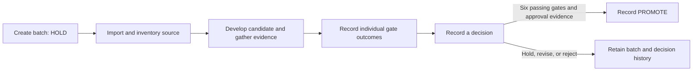

# Mill Factory architecture

Mill Factory is a PowerShell toolkit for keeping a work batch inspectable from source intake through a recorded decision. A batch puts source, candidate work, validation evidence, and decisions in separate places. Its initial decision is `HOLD`. Creating a batch gives the work a structure; it does not validate a candidate or authorize promotion.

## How the pieces fit

These are separate operations. Importing a ZIP does not run its contents. Structural validation can be useful at any point in the workflow; it does not pass a compiler, package, or live gate on the operator's behalf.

| Layer | Where to look | Responsibility |
| --- | --- | --- |
| **Batch creation** | [`New-MillBatch.ps1`](New-MillBatch.ps1), [`templates/`](templates/) | Create the dated batch structure, initial metadata, ledgers, and manifest. Refuse to overwrite an existing batch at the same location. |
| **Source and working material** | [`Import-MillSourceArchive.ps1`](Import-MillSourceArchive.ps1); batch `source/`, `candidate/`, `harness/`, `package/` | Inventory and hash supplied archives, preserve a copy, and optionally expand checked paths. Keep candidate and package files distinct from supplied source. |
| **Evidence and state** | Batch `evidence/`, `MILL_BATCH.json`, `GATE_LEDGER.csv`, `DECISION_LEDGER.csv` | Keep current gate and decision state in metadata and retain records of changes in the ledgers. Attach evidence to the gate or decision it supports. |
| **Integrity and consistency** | [`Update-MillManifest.ps1`](Update-MillManifest.ps1), [`Test-MillBatch.ps1`](Test-MillBatch.ps1) | Generate or compare a SHA-256 file inventory; check the batch structure and internal records. A digest tells you which bytes were checked. |
| **Gates and decisions** | [`Set-MillGate.ps1`](Set-MillGate.ps1), [`Set-MillDecision.ps1`](Set-MillDecision.ps1) | Record individual gate results and a disposition. The decision tool refuses `PROMOTE` when any required gate is not `PASS`, the authorizer is unnamed, or a valid batch-relative approval-evidence file is missing. |

## Boundaries that matter

The six gates are `source_freeze`, `candidate`, `static`, `compiler`, `package`, and `live`. A non-pending gate result requires an evidence file inside the batch. The gate tool records the declared outcome and its reference; it does not independently establish the truth or adequacy of that evidence. `BLOCKED` can record that a check could not proceed. It does not act as a passing result.

`HOLD`, `REVISE`, and `REJECT` record dispositions without promoting the batch. `PROMOTE` records a separate state transition after the checks above. It does not deploy the candidate or grant authority outside the batch. The gate and decision tools refuse to modify a promoted batch; this is a tool-level guard, not filesystem write protection. Later work belongs in a new batch.

Sentinel, reference, and glue records help distinguish unavailable or unsafe states, the identity of the object being referenced, and the conditions for crossing between producer and consumer interfaces. A structural check of those records does not prove that a transformation preserved meaning.

The external [Instrumentation controllers](../Instrumentation/README.md) are fitted examples for declared Mill interfaces. Their receipts can document an operation without substituting for Mill's gate evidence or the human decision.

Use the [disposable batch walkthrough](HOW_TO.md) for a direct-use example. The [validation record](VALIDATION.md) describes the existing controls and the limits of their evidence.
