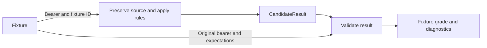

# Semantic Symbol Interpreter architecture

Semantic Symbol Interpreter studies how a source supports an interpretation: what is present, what it may mean in context, and what follows if that reading is supported. Its starting point is to preserve the **whole message bearer** before interpreting any part of it. A mark on its own may be ambiguous; a heading, neighboring line, local legend, or earlier state may supply the evidence that distinguishes two readings.

This document separates the **design described in the recovered project history** from the **behavior of the v0.2.1 prototype**. The prototype uses rules over synthetic text and supplied textual descriptions. The broader design describes capabilities and records that are not all implemented. For use cases and a runnable example, start with the [README](README.md).

## Evidence, occurrences, and interpretation

The bearer is the source that carries a message. In the prototype it is supplied text, optionally in segments. In the broader design it could include spatial or temporal structure: positions, regions, frames, and relations among them. Dilation is the act of considering more of the **already preserved** evidence. It does not mean reconstructing a part of the source that was never captured.

Source and interpretation have different lifetimes. An observed line remains the same even if a rule is revised or a candidate is rejected. The same glyph at two locations can belong to one symbol family while playing different roles in different scopes. A full occurrence model would retain both locations and both readings instead of merging them by spelling or claim text.

The recovered design also separates raw, canonical, normalized, presentation, resolved-symbolic, and semantic forms. For example, grouping a visible expression is a presentation decision; deciding what operation the group denotes is a semantic decision. Keeping the forms and their transformation history separate would let a reviewer trace an interpretation back without treating the transformation as part of the observation. v0.2.1 preserves the bearer and emits derived candidates; it does not construct all these layers.

## Semantic levels and lenses

`OBJECT → SYMBOL → SIGN → MESSAGE → IMPLICATION` names distinctions in the design. It is not a requirement to run five passes in a fixed order or to produce one node at every level. A proposed reading can inform which grouping to consider next, but it cannot rewrite the observed source.

| Level | Question |
| --- | --- |
| **Object** | What item or mark is present in the source? |
| **Symbol** | What identity or role might that mark have in this notation? |
| **Sign** | What communicative unit is formed by one or more marks in this setting? |
| **Message** | What does that unit express? |
| **Implication** | What consequence is supported by the message and the available context? |

At each of the four interpretive levels—symbol, sign, message, and implication—the recovered design applies four independent lenses:

| Lens | Question | Example |
| --- | --- | --- |
| **Atomics** | What are the constituents of this candidate? | Which marks form an operator, or which clauses form a directive? |
| **Dilation** | How does the reading change when more preserved evidence is considered? | Does a heading or neighboring line settle a reading that was ambiguous in isolation? |
| **Macro dynamics** | What does this candidate do in the larger structure? | Does it bind an expression, change a decoding mode, or activate a conditional consequence? |
| **Meta context** | Which convention or interpretive regime applies? | Is `|` a shell pipe, a mathematical relation, or a mark defined by a local legend? |

A well-supported reading through one lens does not settle another lens. Recognizing the parts of a conditional directive, for instance, does not establish that its condition holds. Fixture annotations track representation across these dimensions. They are not per-candidate lens records, and coverage does not establish that each lens is implemented at each level.

## Candidates, transitions, and uncertainty

The recovered history describes an `InterpretationObject` with a level and lens-specific analysis, and an `InterpretationTransition` linking interpretations with a relation type, evidence, rules, context, confidence, and provenance. These describe the intended model; they are not names of the current public JSON types. v0.2.1 records a subset as candidates, rule references, and dependency IDs. A dependency points to related evidence or a candidate, but does not encode the full meaning or justification of a transition.

Uncertainty belongs to a particular question. If the source gives conflicting alarm states, both readings can be retained as `CONFLICTED`. If the source does not establish the alarm state, it is unknown, and directive activation cannot be inferred. `NOT_APPLICABLE` identifies an assessment dimension that does not apply; it is not a negative answer to that assessment. Keeping candidate status separate from truth assessment avoids presenting a proposed reading as an observed fact.

## What v0.2.1 runs

1. **Preserve.** [`engine/minimal_interpreter.py`](engine/minimal_interpreter.py) reads the supplied bearer and fixture identifier. [`engine/trace.py`](engine/trace.py) retains the bearer and records whole-segment and line observations. Offsets are counted in Unicode code points within a segment, with an exclusive end. Rules use derived text without changing the preserved input.
2. **Interpret.** The engine applies explicit pattern rules. For example, [`WB-021`](fixtures/wb-021.json) contains both `ALARM ACTIVE` and `IF ALARM ACTIVE -> EVACUATE` on separate lines. The observed state supports the activation implication. [`WB-031`](fixtures/wb-031.json) contains the conditional directive without a separate activating state. The words inside the condition are not evidence that the condition holds, so activation remains `CANNOT_INFER`.
3. **Record.** The output uses [`CandidateResult`](schemas/candidate-result.schema.json). Its flat `claims`, `unknowns`, `provenance`, and `invariants` fields remain compatible with the legacy harness contract. The optional [`interpretation` extension](schemas/interpretation.schema.json) retains observations, rule records, candidates, alternatives, assessments, and their dependencies. The engine records whole-segment dependencies conservatively; it does not identify the smallest sufficient span for every claim.
4. **Validate.** [`runner/run_validation.py`](runner/run_validation.py) grades the result separately. Expected claims, required unknowns, and forbidden claims come from the fixture and are not supplied to the interpreter as evidence. When the structured extension is present, the validator also checks source fidelity and the structure of the dependency records. The result is a grade for the fixture, not a judgment about what to do outside it.

## What validation establishes

| Check | What it establishes | Boundary |
| --- | --- | --- |
| **Source and reference checks** | The structured result preserves the fixture bearer; spans and references are valid; dependencies are acyclic; implication candidates link to a message or sign. | Valid references do not prove that the referenced evidence entails a conclusion. Whole-bearer scope labels do not establish that a local rule stayed within a region. |
| **Fixture grading** | Expected claims are present, required unknowns are retained, and explicitly forbidden claims are absent. | A zero overreach count means no listed forbidden claim appeared. It does not rule out every unsupported extra claim. |
| **Coverage and benchmark** | Coverage measures fixture representation at configured thresholds. The recorded v0.2.1 benchmark passed 48 of 74 fixtures. | Neither measure establishes real-world accuracy or a complete implementation of the architecture. |

See the [validation report](validation/VALIDATION_REPORT.md) and [benchmark report](engine/benchmark-report.md) for the recorded release results and remaining failures.

## Open design work

- **Occurrence identity and scope.** Preserve separate interpreted occurrences even when their text is identical. The prototype retains source locations, but deduplicates identical flat claims and uses whole-bearer scope in structured records. A richer model would distinguish occurrence, symbol family, and local interpretation scope.
- **Typed transitions and representation history.** Make the type of a relation explicit, preserve separate representation layers, and retain how a candidate was revised or superseded. Current alternatives and correction-history handling cover specific cases rather than a general lifecycle.
- **Evidence and justification.** Distinguish the evidence dimensions needed for recognition, grounding, and implication support. Define what would justify an extra claim beyond passing structural checks and avoiding a forbidden string.
- **Broader bearers and failure cases.** Classify existing benchmark failures by the missing mechanism before expanding rule coverage. Spatial and temporal interpretation beyond the supplied descriptions requires its own representation and validation work. v0.2.1 does not perform OCR, computer vision, or audio or tactile perception.
