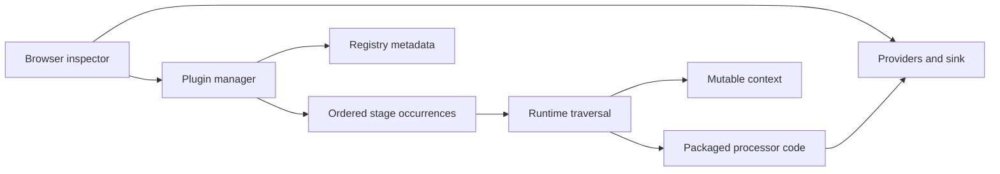

# Source learning catalogue for Plugin Pipeline v7

Review date: 2026-10-29 (America/New_York). AUTH-10.

This catalogue is a selective learning record, not an adopted design or a runtime validation report. The user instructed: catalogue lessons, anti-lessons, patterns, antipatterns, structures, edifices and related learning; do not wholesale lift. Every proposed application remains **not adopted**.

## Scope and source identity

Source archive: `C:/Users/<local-user>/Downloads/modular_recursive_plugin_pipeline_v7_insertable_regex.zip`.

Archive SHA-256: `25b0e2e84a4465d07afe3f621f24cbdeb18767d02b1cccbed383732452a5f95b`.

All nine files were reviewed as text inside the ZIP. No supplied JavaScript was evaluated, no browser UI was launched, no dependencies were installed and no code was integrated. Source instructions and hardening claims are evidence to assess, not authority to act. The original archive remains unchanged.

The application context is the current native AI-originated document direction, direct references and ordered assemblies, immutable resulting streams, CPU-first development and final agentic-control integration. Reference widths, catalogue schemas, higher-level interning and exact return/codepage semantics remain unresolved.

No mining or standardization report was designated for this source; this is manual source-code/document review, not inferred corpus parsing or marker classification.

Locations below refer to entries inside the ZIP, not extracted local files. Line numbering follows the locator convention in learning_catalog.json. SOURCE_MANIFEST.json contains complete per-entry hashes and review/validation coverage.

## Evidence and use rules

- **Source claim:** what the source says about itself; not a verified guarantee.
- **Static observation:** a directly inspected declaration, relationship or branch.
- **Assistant inference:** the interpretation or predicted effect; runtime effects remain untested.
- **Proposed application:** a possible use for Docstream; inclusion is not adoption or implementation clearance.
- **Future validation:** checks that would be needed before an authorized adaptation, not tests performed in this review.

The four dispositions are reference only, candidate adaptation, avoid as implemented, and requires validation. They apply under each record's stated conditions. A source can be useful for an inspector while unsuitable for authoritative immutable content.

## Reviewed source inventory

| ZIP-relative file | Bytes | Lines | Evidence anchors | SHA-256 prefix |
| --- | ---: | ---: | ---: | --- |
| `adapters.js` | 1521 | 57 | 4 | `3b35f5f804228748` |
| `dummy-plugin.js` | 1477 | 51 | 2 | `32e2923e66c68663` |
| `index.html` | 3183 | 99 | 2 | `0b081e3e2e5fb6a8` |
| `pipeline.js` | 19389 | 603 | 38 | `9978f32708c3d0fb` |
| `plugins.js` | 5317 | 159 | 11 | `e68c4adf024c8f74` |
| `README.md` | 1073 | 47 | 4 | `b8faaf7f9d3b8afe` |
| `regex-plugin.js` | 2676 | 111 | 5 | `3a97435aa26a318e` |
| `style.css` | 1732 | 1 | 1 | `e0a5523adb2765ff` |
| `ui.js` | 8014 | 235 | 5 | `ee019e6e31746c64` |

Inventory: 9 files, 1 explicit directory entry, 44,382 uncompressed file bytes. The stylesheet's dense line is counted as source text; it was not visually executed.

## Working catalogue lenses

Categories may overlap. Their counts are lens memberships, not additional independent findings.

| Lens | Meaning | Memberships |
| --- | --- | ---: |
| Lesson | A useful principle supported by the source observation. | 11 |
| Anti-lesson | A conclusion or guarantee that should not be inferred from this source. | 14 |
| Pattern | A potentially reusable arrangement of responsibilities or behavior. | 10 |
| Antipattern | An arrangement unsuitable under the stated application conditions. | 6 |
| Structure | A concrete component, record, interface or relationship. | 18 |
| Edifice | A larger composition of structures and its operating assumptions. | 5 |
| Mechanism | How a behavior is arranged or carried out. | 13 |
| Invariant | A condition a future application would need to maintain. | 19 |
| Failure mode | A source-observed gap or a specifically labeled predicted failure. | 12 |
| Trade-off | A benefit and cost that depend on purpose or environment. | 13 |
| Open question | A question unresolved by this static review. | 8 |

## Entry index

| ID | Learning | Disposition |
| --- | --- | --- |
| [PP7-001](#pp7-001) | Separate definitions from occurrences | Candidate adaptation |
| [PP7-002](#pp7-002) | A registry key does not freeze a definition | Avoid as implemented |
| [PP7-003](#pp7-003) | Frozen metadata has a specific boundary | Candidate adaptation |
| [PP7-004](#pp7-004) | Keep environment adapters separate from processing | Candidate adaptation |
| [PP7-005](#pp7-005) | Explicit entry and terminal sentinels clarify a pass | Candidate adaptation |
| [PP7-006](#pp7-006) | An inspectable ordered stage list is an assembly structure | Candidate adaptation |
| [PP7-007](#pp7-007) | Dependency warnings are not execution preconditions | Avoid as implemented |
| [PP7-008](#pp7-008) | Repeated types require occurrence-aware dependency checks | Requires validation |
| [PP7-009](#pp7-009) | Declared support labels do not establish a data contract | Candidate adaptation |
| [PP7-010](#pp7-010) | Discovery metadata and activation are different operations | Candidate adaptation |
| [PP7-011](#pp7-011) | Linear recursive traversal is not hierarchical content assembly | Reference only |
| [PP7-012](#pp7-012) | Shared mutable context changes the history model | Avoid as implemented |
| [PP7-013](#pp7-013) | Analysis tokens are not a complete native document stream | Avoid as implemented |
| [PP7-014](#pp7-014) | Convenience normalization can alter source content | Avoid as implemented |
| [PP7-015](#pp7-015) | Coordinates need an explicit meaning | Candidate adaptation |
| [PP7-016](#pp7-016) | Derived frequency indexes have their own rules and key domain | Requires validation |
| [PP7-017](#pp7-017) | Valid falsy values require consistent boundary treatment | Requires validation |
| [PP7-018](#pp7-018) | Result caps do not bound a single regex evaluation | Avoid as implemented |
| [PP7-019](#pp7-019) | Bounded scanners need correct progress and honest completion | Requires validation |
| [PP7-020](#pp7-020) | Analysis can be keyed by its processing occurrence | Candidate adaptation |
| [PP7-021](#pp7-021) | Periodic polling and change-driven work have different costs | Reference only |
| [PP7-022](#pp7-022) | A visible run state is not a single-flight guard | Requires validation |
| [PP7-023](#pp7-023) | Lifecycle signals need completion-generation rules | Requires validation |
| [PP7-024](#pp7-024) | Bound all retained run state rather than only the debug log | Avoid as implemented |
| [PP7-025](#pp7-025) | Publication and its evidence require a consistent boundary | Candidate adaptation |
| [PP7-026](#pp7-026) | Multiple state fields need one truthful outcome contract | Requires validation |
| [PP7-027](#pp7-027) | Telemetry, repeatability and attestation are separate claims | Candidate adaptation |
| [PP7-028](#pp7-028) | Copying and naming checks do not establish an immutable safe boundary | Reference only |
| [PP7-029](#pp7-029) | Plugin categories do not isolate execution authority | Reference only |
| [PP7-030](#pp7-030) | Inspection views can stay separate from authoritative output | Candidate adaptation |
| [PP7-031](#pp7-031) | An inspector's presentation is not a document renderer contract | Reference only |
| [PP7-032](#pp7-032) | Edifice: a packaged browser pipeline demonstrator | Reference only |
| [PP7-033](#pp7-033) | Edifice boundary: the native reference data plane is still a separate design | Reference only |
| [PP7-034](#pp7-034) | A version label and README claims are not validation evidence | Reference only |
| [PP7-035](#pp7-035) | Selective adaptation is a traceable design operation | Candidate adaptation |
| [PP7-036](#pp7-036) | A no-content-change stage can still be an observable occurrence | Candidate adaptation |

## Larger compositions and their boundaries

**Source edifice (PP7-032):** the page composes classic scripts, browser providers/sinks, a registry and manager, an ordered stage list, a mutable runtime context and an inspector. The following is an assistant-authored relationship sketch from static source, not an executed trace.



**Native data-plane boundary (PP7-033):** this source does not supply the proposed catalogue of native units, stable direct references and word/sentence/paragraph assemblies. Those require their own design. A processor stage and a character lookup are different structures.

**Selective adaptation (PP7-035):** carry individual principles into a new proposal with explicit requirements and rejected assumptions. Do not transplant the default pipeline, class tree, UI, safety names or source taxonomy as a whole.

## Application map for later proposals

| Concern | Relevant learning | Current status |
| --- | --- | --- |
| Definition/occurrence identity and redefinition | PP7-001, PP7-002, PP7-003, PP7-015 | Candidate principles; native schema not defined |
| Boundaries and dependencies | PP7-004, PP7-007, PP7-008, PP7-009, PP7-028 | Contract and validation design needed |
| Plan order and lifecycle | PP7-005, PP7-006, PP7-022, PP7-023, PP7-026 | Preserve existing durable/immutable requirements |
| Analysis around native content | PP7-013 through PP7-020 | Optional derived views; not the authoritative unit stream |
| History, no-ops and publication | PP7-012, PP7-024, PP7-025, PP7-027, PP7-036 | Distinguish content, occurrences, telemetry and durable outcomes |
| Whole-system composition | PP7-010, PP7-011, PP7-029 through PP7-035 | Reference material only; no integration approved |

## Detailed records

### PP7-001

**Separate definitions from occurrences**

**Lenses:** Lesson, Pattern, Structure, Invariant.
**Disposition:** Candidate adaptation. **Application status:** not adopted.

**Source evidence**

- **Static observation** — `pipeline.js:197-241`, `RegistryEntry and PipelineNode`. Registry metadata uses typeId while runtime nodes also carry instanceId; loaded instances receive distinct counter-based IDs.

```text
this.instanceId=instanceId||typeId;
```

- **Static observation** — `pipeline.js:368-384`, `PluginManager.load`. A loaded instance is distinguished from its installed type.

```text
plugin.instanceId=this.makeInstanceId(typeId);
```

**Assistant inference**

A reusable definition and an occurrence are different identities. The source demonstrates this for processors, not characters or native assembly objects.

**Proposed application**

Define native unit identity, assembly occurrence identity and processing occurrence identity separately. Reuse the principle after specifying their own contracts.

**Assumptions and limits**

- The local counter does not establish durable identity across sessions.
- Plugin identity is not automatically a native character reference.

**Validation needed before any future adaptation**

- Repeated definitions remain distinguishable from repeated occurrences.
- Restart and reference-resolution rules are explicit.

**Related or contrasting records:** [PP7-002](#pp7-002) (constrained by).

### PP7-002

**A registry key does not freeze a definition**

**Lenses:** Anti-lesson, Antipattern, Failure mode, Invariant.
**Disposition:** Avoid as implemented. **Application status:** not adopted.

**Source evidence**

- **Static observation** — `pipeline.js:292-308`, `PluginRegistry.register`. Registering an existing typeId replaces the registry entry without a version check.

```text
this.entries.set(entry.typeId,entry);
```

- **Static observation** — `pipeline.js:350-366`, `PluginManager.install`. An installed factory is also stored by the replaceable type key.

```text
this.installed.set(prototypePlugin.typeId,{
```

**Assistant inference**

A repeated name can select a changed definition. The registry alone does not provide the stable meanings needed to withstand redefinition.

**Proposed application**

Consider immutable definition identities and explicit version/content binding for native maps. A new definition would need a deliberate new binding rather than silent replacement.

**Assumptions and limits**

- The archive does not promise a persistent versioned registry.
- The particular version/hash policy remains undecided.

**Validation needed before any future adaptation**

- A redefinition cannot reinterpret a prior assembly.
- Conflicting registration is rejected or explicitly versioned.

**Related or contrasting records:** [PP7-001](#pp7-001) (constrains); [PP7-003](#pp7-003) (complements).

### PP7-003

**Frozen metadata has a specific boundary**

**Lenses:** Lesson, Structure, Anti-lesson.
**Disposition:** Candidate adaptation. **Application status:** not adopted.

**Source evidence**

- **Static observation** — `pipeline.js:197-227`, `RegistryEntry and PipelineNode constructors`. RegistryEntry freezes itself and its declared arrays; ordinary PipelineNode instances remain mutable apart from those arrays.

```text
Object.freeze(this);
```

**Assistant inference**

Metadata immutability is useful but does not freeze the plugin implementation, runtime instance, context or registry binding.

**Proposed application**

Describe exactly which native values are immutable, and keep that guarantee separate from registry replacement and execution state.

**Assumptions and limits**

- A freeze operation is not a complete persistence or authority policy.

**Validation needed before any future adaptation**

- Mutations at each promised immutable boundary are rejected.
- Execution configuration is captured separately from mutable UI state.

**Related or contrasting records:** [PP7-002](#pp7-002) (complements); [PP7-012](#pp7-012) (contrasts with).

### PP7-004

**Keep environment adapters separate from processing**

**Lenses:** Lesson, Pattern, Structure.
**Disposition:** Candidate adaptation. **Application status:** not adopted.

**Source evidence**

- **Static observation** — `adapters.js:6-48`, `BrowserReaderProvider, BrowserOutputSink, BrowserRegexProvider`. Browser elements are wrapped in provider/sink objects.

```text
class BrowserReaderProvider{
```

- **Static observation** — `plugins.js:11-43`, `StandardReaderPlugin`. The reader plugin receives a provider rather than reading DOM elements directly.

```text
const envelope=await this.readerProvider.read();
```

**Assistant inference**

The boundary lets processing logic be considered separately from the browser interface.

**Proposed application**

Use explicit interfaces for native input, reference resolution and publication, with their own typed contracts. Keep a future inspector outside authoritative processing logic.

**Assumptions and limits**

- The supplied adapters are browser-specific.
- A provider interface alone does not validate its data.

**Validation needed before any future adaptation**

- Substituting an input/output mechanism preserves the declared semantic result.
- Invalid adapter envelopes are rejected consistently.

**Related or contrasting records:** [PP7-009](#pp7-009) (constrained by); [PP7-032](#pp7-032) (complements).

### PP7-005

**Explicit entry and terminal sentinels clarify a pass**

**Lenses:** Pattern, Structure, Invariant, Trade-off.
**Disposition:** Candidate adaptation. **Application status:** not adopted.

**Source evidence**

- **Static observation** — `pipeline.js:243-282`, `StartNode and StopNode`. START and STOP are fixed system nodes with diagnostic behavior.

```text
typeId:"system.stop",
```

- **Static observation** — `pipeline.js:473-487`, `buildPipelineNodes and validatePipeline`. A pass is bracketed and checked for unique instance IDs and valid interior node types.

```text
const nodes=[new StartNode(),...this.pluginManager.getLoadedPlugins(),new StopNode()];
```

**Assistant inference**

Visible boundaries make a planned pass easier to inspect. The StopNode terminates traversal of that pass; it is not the runtime STOP signal or a durable commit.

**Proposed application**

Give future assembly/execution plans explicit boundaries and terminal outcomes without conflating traversal completion, publication and commit.

**Assumptions and limits**

- The sentinel is not a transaction boundary.
- Per-character dispatch should not be inferred from processor sentinels.

**Validation needed before any future adaptation**

- A failed or interrupted pass cannot claim a successful terminal outcome.

**Related or contrasting records:** [PP7-025](#pp7-025) (constrains); [PP7-026](#pp7-026) (complements).

### PP7-006

**An inspectable ordered stage list is an assembly structure**

**Lenses:** Lesson, Pattern, Structure, Trade-off.
**Disposition:** Candidate adaptation. **Application status:** not adopted.

**Source evidence**

- **Static observation** — `pipeline.js:372-402`, `PluginManager.load, unload and move`. Loaded stage occurrences can be inserted, removed and moved.

```text
this.loaded.splice(index,0,{plugin});
```

- **Static observation** — `ui.js:191-208`, `renderLoadedPlugins`. The UI displays ordered occurrence identities and declared metadata.

```text
for(const plugin of this.runtime.pluginManager.getLoadedPluginRecords()){
```

**Assistant inference**

Ordering can be represented and inspected as data. This list assembles processors; it does not represent word or paragraph composition.

**Proposed application**

Make a future processing plan inspectable before execution, and snapshot its exact ordered identities/configuration. Keep native content assembly as a separate structure.

**Assumptions and limits**

- The current list is live mutable state.
- Changing visible order is not proof that the order is valid.

**Validation needed before any future adaptation**

- Reordering creates an explicit plan revision.
- A running plan remains bound to its captured definition.

**Related or contrasting records:** [PP7-007](#pp7-007) (constrained by); [PP7-033](#pp7-033) (contrasts with).

### PP7-007

**Dependency warnings are not execution preconditions**

**Lenses:** Antipattern, Anti-lesson, Failure mode, Invariant.
**Disposition:** Avoid as implemented. **Application status:** not adopted.

**Source evidence**

- **Static observation** — `pipeline.js:313-336`, `PluginRegistry.validateLoadedOrder`. Missing and misordered dependencies are returned as warnings.

```text
return warnings;
```

- **Static observation** — `pipeline.js:478-489`, `validatePipeline`. Pipeline validation logs dependency warnings without rejecting execution.

```text
if(warnings.length) this.debug.log("warn","Pipeline dependency warnings detected.",{warnings});
```

**Assistant inference**

A processor may run without a producer it declared necessary. Diagnostics alone do not establish valid dataflow.

**Proposed application**

Define which dependencies are mandatory, validate them before authoritative execution, and report an invalid plan rather than silently using stale/default state.

**Assumptions and limits**

- Warning-only behavior can be suitable for a permissive demonstrator.
- The native dependency contract is not defined by this archive.

**Validation needed before any future adaptation**

- Remove or reorder a required stage and verify a declared rejection before mutation/publication.

**Related or contrasting records:** [PP7-008](#pp7-008) (complements); [PP7-009](#pp7-009) (complements).

### PP7-008

**Repeated types require occurrence-aware dependency checks**

**Lenses:** Failure mode, Structure, Open question.
**Disposition:** Requires validation. **Application status:** not adopted.

**Source evidence**

- **Static observation** — `pipeline.js:313-332`, `validateLoadedOrder`. Dependency ordering compares the first occurrence of each type rather than the current record's position.

```text
typeIds.indexOf(requiredTypeId)>typeIds.indexOf(record.plugin.typeId)
```

**Assistant inference**

With repeated dependent types, a later instance can be assessed against an earlier instance's position. The code does not specify which producer occurrence supplies which consumer.

**Proposed application**

Bind repeated processors to explicit predecessor/output occurrences or a declared selection rule. Do not infer dataflow solely from matching type names.

**Assumptions and limits**

- The problematic runtime sequence has not been executed.
- Different dependency semantics may intentionally require an early producer.

**Validation needed before any future adaptation**

- Exercise repeated producers/consumers on both sides of a required stage and compare with the declared occurrence-binding rule.

**Related or contrasting records:** [PP7-001](#pp7-001) (depends on); [PP7-007](#pp7-007) (complements).

### PP7-009

**Declared support labels do not establish a data contract**

**Lenses:** Anti-lesson, Structure, Invariant.
**Disposition:** Candidate adaptation. **Application status:** not adopted.

**Source evidence**

- **Static observation** — `pipeline.js:197-210`, `RegistryEntry`. Support metadata is a string list.

```text
this.supports=Object.freeze([...supports]);
```

- **Static observation** — `pipeline.js:491-504`, `executeRecursive`. Execution invokes a node without validating declared input/output shapes or checking a support label against context data.

```text
const nextContext=await node.execute(context,this);
```

**Assistant inference**

A JSON/universal label is useful discovery metadata but not a schema, semantic guarantee or native codepage contract.

**Proposed application**

Specify accepted native structures, produced structures, map versions and failure behavior for each coarse processing operation.

**Assumptions and limits**

- Individual supplied plugins perform some local checks.
- No universal type system should be inferred from enum names.

**Validation needed before any future adaptation**

- Mismatched inputs and invalid outputs fail at their declared boundary.

**Related or contrasting records:** [PP7-028](#pp7-028) (constrained by); [PP7-007](#pp7-007) (complements).

### PP7-010

**Discovery metadata and activation are different operations**

**Lenses:** Lesson, Mechanism, Trade-off, Failure mode.
**Disposition:** Candidate adaptation. **Application status:** not adopted.

**Source evidence**

- **Static observation** — `pipeline.js:350-365`, `PluginManager.install`. Installation constructs a real plugin to obtain its metadata.

```text
const prototypePlugin=new factory(...args);
```

- **Static observation** — `pipeline.js:372-381`, `PluginManager.load`. Loading constructs another instance.

```text
const plugin=new record.factory(...record.args);
```

**Assistant inference**

A constructor may be invoked during discovery and again during activation. Future constructor side effects would therefore run at both stages; the supplied examples do not demonstrate harmful effects.

**Proposed application**

Consider inert definition records for discovery and explicit activation of an execution occurrence. Keep native unit lookup free of processor startup.

**Assumptions and limits**

- The example constructors mostly initialize metadata and validate arguments.
- No external plugin was installed or executed in this review.

**Validation needed before any future adaptation**

- Listing definitions performs no hidden I/O or execution.
- Activation side effects occur only at the declared boundary.

**Related or contrasting records:** [PP7-029](#pp7-029) (complements); [PP7-033](#pp7-033) (constrains).

### PP7-011

**Linear recursive traversal is not hierarchical content assembly**

**Lenses:** Anti-lesson, Mechanism, Edifice.
**Disposition:** Reference only. **Application status:** not adopted.

**Source evidence**

- **Static observation** — `pipeline.js:491-504`, `RecursivePipelineRuntime.executeRecursive`. Recursion advances through a flat node array.

```text
return this.executeRecursive(nodes,index+1,nextContext);
```

- **Source claim** — `README.md:22-38`, `Runtime shape and default pipeline`. The README describes a start/plugins/stop runtime shape.

```text
→ loaded plugin instances
```

**Assistant inference**

The word recursive does not establish reusable child assemblies, graph references, word/sentence composition or memoized substructure.

**Proposed application**

Define native assembly explicitly with its own unit/child relationships and cycle rules. Use processing traversal only for processing traversal.

**Assumptions and limits**

- This is not a claim that the source intended to implement a native document graph.

**Validation needed before any future adaptation**

- A future hierarchical assembler preserves ordered children, shared definitions and the declared cycle/depth policy.

**Related or contrasting records:** [PP7-006](#pp7-006) (contrasts with); [PP7-033](#pp7-033) (complements).

### PP7-012

**Shared mutable context changes the history model**

**Lenses:** Antipattern, Structure, Trade-off, Invariant.
**Disposition:** Avoid as implemented. **Application status:** not adopted.

**Source evidence**

- **Static observation** — `pipeline.js:458-471`, `createFreshContext`. A run owns a mutable object with data, derived states, output, stream, diagnostics and errors.

```text
tokenizerState:{},
```

- **Static observation** — `plugins.js:105-110`, `WordCountPlugin.execute`. A processor writes its result into the input data object.

```text
context.data._pluginWordCount=wordCount;
```

**Assistant inference**

Later stages can overwrite content or derived state. This differs from immutable input/output values and addressable historical transformations.

**Proposed application**

Preserve immutable native inputs and explicit resulting assemblies. Keep derived measurements separate from authoritative content and bind them to an input identity.

**Assumptions and limits**

- Mutable context is convenient for a small browser demo.
- Cloned output snapshots do not provide a complete durable lineage model.

**Validation needed before any future adaptation**

- Earlier assemblies remain byte/semantically unchanged after later operations.
- Derived analysis cannot alter its source content.

**Related or contrasting records:** [PP7-003](#pp7-003) (contrasts with); [PP7-024](#pp7-024) (complements).

### PP7-013

**Analysis tokens are not a complete native document stream**

**Lenses:** Anti-lesson, Mechanism, Invariant.
**Disposition:** Avoid as implemented. **Application status:** not adopted.

**Source evidence**

- **Static observation** — `plugins.js:58-85`, `StatefulTokenizerPlugin.execute`. The matcher collects word/symbol tokens and omits whitespace from its token list.

```text
const regex=/\b[\p{L}\p{N}_'-]+\b|[^\s]/gu;
```

**Assistant inference**

Tokens may support analysis while failing to encode spaces, returns and all native units as ordered entries. Original text is still available in context; the token list alone is not established as lossless.

**Proposed application**

Keep every required native unit/control reference in authoritative assemblies. Derive analytical token views separately when useful.

**Assumptions and limits**

- The archive describes tokenization for analysis rather than a lossless codec.
- Native return semantics remain an explicit design question.

**Validation needed before any future adaptation**

- Reconstruct text/control structure from native references without consulting discarded whitespace.
- Analysis leaves the original assembly unchanged.

**Related or contrasting records:** [PP7-014](#pp7-014) (complements); [PP7-015](#pp7-015) (complements); [PP7-033](#pp7-033) (constrains).

### PP7-014

**Convenience normalization can alter source content**

**Lenses:** Antipattern, Mechanism, Failure mode.
**Disposition:** Avoid as implemented. **Application status:** not adopted.

**Source evidence**

- **Static observation** — `pipeline.js:165-170`, `SecurityUtil.normalizeTextToJson`. Plain-text input is trimmed before JSON detection or wrapping as text.

```text
const trimmed=text.trim();
```

**Assistant inference**

Leading/trailing whitespace can be removed and JSON-looking text can be reinterpreted as a value. These are meaningful transformations if input is authoritative text.

**Proposed application**

Make the input kind explicit. Preserve native content and record any requested normalization as a transformation with a defined policy.

**Assumptions and limits**

- Trimming can be an intentional UI convenience; it is unsuitable as an implicit native-source rule.

**Validation needed before any future adaptation**

- Leading/trailing spaces, blank content and JSON-looking literal text retain their intended identities.

**Related or contrasting records:** [PP7-013](#pp7-013) (complements); [PP7-017](#pp7-017) (complements).

### PP7-015

**Coordinates need an explicit meaning**

**Lenses:** Structure, Invariant, Open question.
**Disposition:** Candidate adaptation. **Application status:** not adopted.

**Source evidence**

- **Static observation** — `plugins.js:66-74`, `Token records`. Token start/end use JavaScript string positions and lengths; no coordinate-unit contract accompanies the fields.

```text
end:match.index+value.length,
```

- **Static observation** — `regex-plugin.js:47-52`, `Regex match records`. Regex results also expose string positions.

```text
index:match.index,
```

**Assistant inference**

A numeric offset cannot automatically be treated as a native unit reference, displayed character index or stable historical target.

**Proposed application**

Declare coordinate units and their input-version binding wherever text ranges coexist with native references.

**Assumptions and limits**

- No Unicode position conversion was executed in this review.
- The future native coordinate scheme is not chosen here.

**Validation needed before any future adaptation**

- Combining sequences, supplementary characters and edits preserve declared addressing behavior.

**Related or contrasting records:** [PP7-001](#pp7-001) (complements); [PP7-013](#pp7-013) (constrains).

### PP7-016

**Derived frequency indexes have their own rules and key domain**

**Lenses:** Lesson, Mechanism, Trade-off, Failure mode.
**Disposition:** Requires validation. **Application status:** not adopted.

**Source evidence**

- **Static observation** — `plugins.js:76-80`, `Token frequencies`. Frequency keys are folded to lowercase and stored in a normal object accumulator.

```text
const key=token.value.toLowerCase();
```

**Assistant inference**

Case-insensitive statistics do not define canonical character identity. User-derived keys such as inherited object-property names also need deliberate dictionary semantics.

**Proposed application**

Bind derived indexes to an assembly and explicit analysis policy. Use a key representation that handles every permitted native value without inherited-property ambiguity.

**Assumptions and limits**

- The original token.value retains its case.
- Prototype-key effects are predicted from the accumulator structure, not runtime-tested exploits.

**Validation needed before any future adaptation**

- Mixed case remains distinct in authoritative content.
- Keys such as constructor and __proto__ are handled as ordinary data under the declared counting policy.

**Related or contrasting records:** [PP7-012](#pp7-012) (constrains); [PP7-028](#pp7-028) (complements).

### PP7-017

**Valid falsy values require consistent boundary treatment**

**Lenses:** Failure mode, Mechanism, Invariant.
**Disposition:** Requires validation. **Application status:** not adopted.

**Source evidence**

- **Static observation** — `plugins.js:58-61`, `Tokenizer source selection`. The fallback substitutes an empty object for falsy data.

```text
: JSON.stringify(context.data||{},null,2);
```

- **Static observation** — `plugins.js:105-109`, `WordCountPlugin.execute`. Counting replaces non-object/falsy content with an object before adding its result.

```text
if(!context.data||typeof context.data!=="object") context.data={};
```

- **Static observation** — `plugins.js:29-35`, `Reader modes`. The file/text JSON parsing paths are not limited to object roots by a subsequent plain-object check.

```text
data=SecurityUtil.safeJsonParse(value,"JSON file content");
```

**Assistant inference**

Input modes and downstream assumptions disagree for values such as false, zero or null. Absence and a legitimate value should have different rules.

**Proposed application**

Define the accepted native envelope and preserve every valid value. Reject unsupported shapes explicitly instead of silently replacing them.

**Assumptions and limits**

- This review did not execute the affected JSON inputs.

**Validation needed before any future adaptation**

- All input modes agree on object/primitive acceptance.
- Valid zero/false/empty values are not confused with missing data.

**Related or contrasting records:** [PP7-009](#pp7-009) (constrains); [PP7-014](#pp7-014) (complements).

### PP7-018

**Result caps do not bound a single regex evaluation**

**Lenses:** Anti-lesson, Failure mode, Invariant.
**Disposition:** Avoid as implemented. **Application status:** not adopted.

**Source evidence**

- **Static observation** — `pipeline.js:173-178`, `createSafeRegex`. The helper validates length and flags before creating a native RegExp.

```text
if(source.length>500) throw new RangeError("Regex source too long.");
```

- **Static observation** — `regex-plugin.js:38-60`, `runRegex`. Execution is synchronous; the match cap is checked only after exec returns.

```text
while((match=scanRegex.exec(sourceText))!==null){
```

**Assistant inference**

The name safe and the match-count limit do not establish a runtime deadline or interrupt a slow evaluation.

**Proposed application**

If regex analysis is retained, specify input/pattern limits and a genuinely enforceable execution budget. Keep it optional around native assemblies.

**Assumptions and limits**

- No pathological expression was executed.
- Actual engine behavior must be measured within an approved worker/timeout scope.

**Validation needed before any future adaptation**

- A slow expression terminates within its deadline without blocking authoritative service work.

**Related or contrasting records:** [PP7-019](#pp7-019) (complements); [PP7-023](#pp7-023) (complements).

### PP7-019

**Bounded scanners need correct progress and honest completion**

**Lenses:** Mechanism, Invariant, Open question, Trade-off.
**Disposition:** Requires validation. **Application status:** not adopted.

**Source evidence**

- **Static observation** — `regex-plugin.js:47-70`, `runRegex scan loop and result`. Zero-length matches manually advance the index; scans stop at maxMatches, but the result has no truncated/completion field.

```text
scanRegex.lastIndex+=1;
```

**Assistant inference**

A scanner must both make valid progress in its coordinate model and distinguish a complete result from a capped prefix.

**Proposed application**

Declare continuation/completion and coordinate rules for analytical scans. Do not let a capped analysis masquerade as complete assembly knowledge.

**Assumptions and limits**

- Unicode zero-width cases were not executed.
- The match cap itself is a useful resource mechanism.

**Validation needed before any future adaptation**

- Test empty matches, supplementary characters and exact-cap versus over-cap scans.
- A partial result advertises its completeness state.

**Related or contrasting records:** [PP7-015](#pp7-015) (depends on); [PP7-018](#pp7-018) (complements).

### PP7-020

**Analysis can be keyed by its processing occurrence**

**Lenses:** Pattern, Structure, Lesson.
**Disposition:** Candidate adaptation. **Application status:** not adopted.

**Source evidence**

- **Static observation** — `regex-plugin.js:75-87`, `RegexPipelinePlugin.execute`. Each loaded regex instance receives its own result slot.

```text
context.regexState[this.instanceId]=result;
```

- **Static observation** — `regex-plugin.js:63-72`, `Regex result`. Results retain pattern/flags, source length, match data and execution time.

```text
executedAt:new Date().toISOString()
```

**Assistant inference**

Distinct analysis occurrences can coexist. An occurrence ID and timestamp alone do not bind the result to immutable content or prove replay equivalence.

**Proposed application**

Address derived analysis by occurrence plus exact input identity, definition/configuration identity and declared result status.

**Assumptions and limits**

- This state is session-local and mutable.
- Regex analysis is not a native unit definition.

**Validation needed before any future adaptation**

- Two analyses preserve their own identities and cannot be attached to the wrong assembly revision.

**Related or contrasting records:** [PP7-001](#pp7-001) (depends on); [PP7-027](#pp7-027) (constrained by).

### PP7-021

**Periodic polling and change-driven work have different costs**

**Lenses:** Trade-off, Mechanism, Pattern, Open question.
**Disposition:** Reference only. **Application status:** not adopted.

**Source evidence**

- **Static observation** — `pipeline.js:447-456`, `Runtime initialization`. The runtime uses a fixed delay.

```text
this.cycleDelayMs=300;
```

- **Static observation** — `pipeline.js:540-555`, `startLoop`. While running, each loop schedules another pass without an input-change test.

```text
this.loopHandle=setTimeout(loop,this.cycleDelayMs);
```

**Assistant inference**

A repeating demo is easy to observe but may redo tokenization/search/publication for unchanged input. The source has no demonstrated content/profile cache or operation reduction.

**Proposed application**

Choose explicit batch/change boundaries and reuse results whose inputs and processing definitions are unchanged. Measure polling separately if a future source actually requires it.

**Assumptions and limits**

- The 300 ms value is not a measured latency requirement.
- No performance benchmark was run.

**Validation needed before any future adaptation**

- Unchanged inputs avoid unnecessary construction/rendering.
- A changed dependency invalidates only the results it actually affects.

**Related or contrasting records:** [PP7-024](#pp7-024) (complements); [PP7-034](#pp7-034) (constrained by).

### PP7-022

**A visible run state is not a single-flight guard**

**Lenses:** Antipattern, Failure mode, Invariant.
**Disposition:** Requires validation. **Application status:** not adopted.

**Source evidence**

- **Static observation** — `pipeline.js:519-529`, `runOnce`. runOnce sets state but does not reject or serialize an already running call.

```text
this.state=RuntimeState.RUNNING;
```

- **Static observation** — `ui.js:88-91`, `Run Once button handler`. The UI handler invokes the same runtime; it has no per-run exclusion flag.

```text
await this.runtime.runOnce();
```

**Assistant inference**

Overlapping calls can interleave when a stage awaits, because shared context and lifecycle state are reused. Actual overlap has not been exercised.

**Proposed application**

Specify owner/queue/concurrency behavior and bind each accepted execution to a unique immutable plan and request outcome.

**Assumptions and limits**

- Synchronous stages do not yield to another button handler during their own body.
- No concurrency test was run against this archive.

**Validation needed before any future adaptation**

- Submit concurrent runs around an asynchronous reader and confirm declared serialization or explicit rejection.

**Related or contrasting records:** [PP7-012](#pp7-012) (depends on); [PP7-023](#pp7-023) (complements).

### PP7-023

**Lifecycle signals need completion-generation rules**

**Lenses:** Mechanism, Failure mode, Invariant, Anti-lesson.
**Disposition:** Requires validation. **Application status:** not adopted.

**Source evidence**

- **Static observation** — `pipeline.js:491-504`, `executeRecursive`. Pause/stop are checked between nodes.

```text
if(index>=nodes.length||this.state===RuntimeState.PAUSED||this.stopRequested) return context;
```

- **Static observation** — `pipeline.js:529-532`, `runOnce completion`. The returned context is assigned after awaited work; completion returns state to running unless error/stop conditions apply.

```text
this.context=await this.executeRecursive(nodes,0,this.context);
```

- **Static observation** — `pipeline.js:572-580`, `PAUSE, RESUME and RESET handling`. Reset replaces context without invalidating an in-flight completion generation.

```text
this.context=this.createFreshContext();
```

**Assistant inference**

A late completion can conflict with a pause/reset request. Cooperative signal checks also cannot interrupt a synchronous long-running node.

**Proposed application**

Define legal state transitions, execution generations and cancellation points. Reject stale completion and use owned workers where interruption must be enforceable.

**Assumptions and limits**

- Timing-dependent pause/reset effects remain predicted, not reproduced.
- A terminal sentinel is distinct from cancellation of a running operation.

**Validation needed before any future adaptation**

- Pause/reset during an awaited node cannot resurrect old state.
- Stop and timeout have bounded, truthful outcomes.

**Related or contrasting records:** [PP7-005](#pp7-005) (contrasts with); [PP7-018](#pp7-018) (complements); [PP7-022](#pp7-022) (depends on).

### PP7-024

**Bound all retained run state rather than only the debug log**

**Lenses:** Antipattern, Structure, Failure mode, Trade-off.
**Disposition:** Avoid as implemented. **Application status:** not adopted.

**Source evidence**

- **Static observation** — `pipeline.js:182-194`, `DebugLogger`. The debug log has a retention count.

```text
if(this.entries.length>this.maxEntries) this.entries.shift();
```

- **Static observation** — `plugins.js:129-146`, `StandardOutputPlugin.execute`. Stream entries and diagnostics accumulate without an equivalent byte/count bound; output includes the growing diagnostics array.

```text
context.stream.push({type:"json-line",value:JSON.stringify(output),emittedAt:new Date().toISOString()});
```

**Assistant inference**

A bounded debug log does not bound total retained state. Repeated serialized diagnostic histories can amplify storage growth across passes.

**Proposed application**

Specify retention, backpressure and durable history independently. Use stable references for repeated material rather than incidental copies of a growing diagnostic history.

**Assumptions and limits**

- No long-duration memory or storage measurements were taken.
- Diagnostic history is different from authoritative transformation history.

**Validation needed before any future adaptation**

- A bounded soak accounts for all retained collections and bytes.
- History preservation and resource caps have an explicit compatibility policy.

**Related or contrasting records:** [PP7-012](#pp7-012) (complements); [PP7-021](#pp7-021) (constrains); [PP7-027](#pp7-027) (complements).

### PP7-025

**Publication and its evidence require a consistent boundary**

**Lenses:** Lesson, Mechanism, Invariant, Open question.
**Disposition:** Candidate adaptation. **Application status:** not adopted.

**Source evidence**

- **Static observation** — `plugins.js:129-147`, `StandardOutputPlugin.execute`. The plugin builds/clones output and calls the sink before appending its output-written diagnostic.

```text
this.outputSink.write(context.output.jsonObject);
```

- **Static observation** — `adapters.js:27-35`, `BrowserOutputSink.write`. The supplied sink copies and displays output in memory.

```text
this.lastObject=SecurityUtil.deepClone(objectValue);
```

**Assistant inference**

The emitted snapshot does not include that pass's later output-written diagnostic. A successful browser display does not establish a durable artifact or an atomic head/receipt transition.

**Proposed application**

Keep construction, publication, verification and commit outcomes distinct, and make the evidence correspond to the exact boundary it claims.

**Assumptions and limits**

- The source is an in-memory display, not a durable storage service.
- No crash/restart publication test was run.

**Validation needed before any future adaptation**

- Failure around publication cannot claim ready output or advance a guarded head.
- Diagnostics identify whether they describe intent, completion or verified persistence.

**Related or contrasting records:** [PP7-005](#pp7-005) (constrained by); [PP7-026](#pp7-026) (complements); [PP7-027](#pp7-027) (complements).

### PP7-026

**Multiple state fields need one truthful outcome contract**

**Lenses:** Failure mode, Structure, Invariant.
**Disposition:** Requires validation. **Application status:** not adopted.

**Source evidence**

- **Static observation** — `pipeline.js:505-516`, `executeRecursive error handling`. The catch block appends an error and changes runtime.state without assigning context.status.

```text
this.state=RuntimeState.ERROR;
```

- **Static observation** — `pipeline.js:519-536`, `runOnce status updates`. The usual context.status update is skipped on the error path.

```text
if(this.state!==RuntimeState.ERROR&&!this.stopRequested){
```

**Assistant inference**

Runtime state and context status can disagree after a failure. If output is not reached, a UI may also retain an earlier successful display.

**Proposed application**

Define an authoritative terminal outcome and bind displayed artifacts/status to the specific execution occurrence. Keep prior successful output identifiable as prior output.

**Assumptions and limits**

- This is a predicted state-consistency issue from static branches, not an executed UI defect.

**Validation needed before any future adaptation**

- A failing stage produces consistent runtime, result, receipt and displayed-output state.

**Related or contrasting records:** [PP7-023](#pp7-023) (complements); [PP7-025](#pp7-025) (complements).

### PP7-027

**Telemetry, repeatability and attestation are separate claims**

**Lenses:** Anti-lesson, Structure, Invariant, Trade-off.
**Disposition:** Candidate adaptation. **Application status:** not adopted.

**Source evidence**

- **Static observation** — `pipeline.js:188-194`, `DebugLogger.log`. Logs contain timestamps and cloned metadata.

```text
time:new Date().toISOString()
```

- **Static observation** — `pipeline.js:458-470`, `createFreshContext`. Run identity is generated in memory; the archive has no durable receipt or sealed-plan mechanism.

```text
runId:(crypto&&crypto.randomUUID)?crypto.randomUUID():"run-"+Date.now()+"-"+Math.random(),
```

**Assistant inference**

A readable log helps diagnose a run but does not prove input identity, deterministic semantics, durable completion or independent attestation.

**Proposed application**

Bind evidence to input/definition/plan/result identities and distinguish deterministic payload from execution telemetry. Keep proof claims within their measured boundary.

**Assumptions and limits**

- Hashing or UUIDs alone would not establish authority or truth.
- The archive is not claimed to be an attestation system.

**Validation needed before any future adaptation**

- Replay compares the promised deterministic material while retaining separate timing/run metadata.

**Related or contrasting records:** [PP7-020](#pp7-020) (constrains); [PP7-024](#pp7-024) (complements); [PP7-034](#pp7-034) (complements).

### PP7-028

**Copying and naming checks do not establish an immutable safe boundary**

**Lenses:** Anti-lesson, Mechanism, Structure, Open question.
**Disposition:** Reference only. **Application status:** not adopted.

**Source evidence**

- **Source claim** — `README.md:7-12`, `deepClone claims`. The README describes hardened cloning with multiple supported types and explicit rejections.

```text
Incorporated hardened `SecurityUtil.deepClone()`:
```

- **Static observation** — `pipeline.js:9-21`, `SecurityUtil.deepClone`. A built-in clone is tried before a manual fallback.

```text
return this.deepCloneManual(value,new WeakMap());
```

- **Static observation** — `pipeline.js:118-150`, `Manual object clone and assertPlainObject`. Fallback retains prototypes/property descriptors; assertPlainObject only rejects null, non-objects and arrays.

```text
const clonedObject=Object.create(Object.getPrototypeOf(value));
```

**Assistant inference**

A clone can isolate some mutation while retaining mutable objects, prototypes and accessor behavior. A helper called plain or hardened does not by itself establish a strict data schema or execution containment.

**Proposed application**

Prefer explicit allowed native value shapes and immutable ownership rules. Adopt only the copy behavior that an actual boundary requires, with declared graph/host-type semantics.

**Assumptions and limits**

- No malicious object or host value was executed.
- JSON-parsed data and live plugin objects have different risk/semantic domains.

**Validation needed before any future adaptation**

- Check accessors, prototypes, unsupported objects and consistent behavior across clone paths.
- Validate shapes rather than relying on helper names.

**Related or contrasting records:** [PP7-003](#pp7-003) (constrains); [PP7-009](#pp7-009) (constrains); [PP7-029](#pp7-029) (complements).

### PP7-029

**Plugin categories do not isolate execution authority**

**Lenses:** Anti-lesson, Edifice, Structure, Trade-off.
**Disposition:** Reference only. **Application status:** not adopted.

**Source evidence**

- **Static observation** — `pipeline.js:4-7`, `NodeType labels`. An external-plugin category is declared.

```text
EXTERNAL_PLUGIN:"external-plugin"
```

- **Static observation** — `pipeline.js:350-365`, `install`. Factories are called as JavaScript constructors in the same environment.

```text
const prototypePlugin=new factory(...args);
```

- **Static observation** — `pipeline.js:491-504`, `Node execution`. Plugins receive the runtime and shared context; no separate execution boundary is created.

```text
const nextContext=await node.execute(context,this);
```

**Assistant inference**

The provided model suits trusted packaged processors. A category label does not make arbitrary extensions contained or safe to activate.

**Proposed application**

Declare processor authority and trust separately from catalogue metadata. A future extension boundary would need its own explicit design and approval.

**Assumptions and limits**

- There is no demonstrated arbitrary-file upload or dynamic remote plugin installer in the supplied UI.
- No containment test was attempted.

**Validation needed before any future adaptation**

- Document exactly which operations each installed processor may perform and how those limits are enforced.

**Related or contrasting records:** [PP7-010](#pp7-010) (complements); [PP7-028](#pp7-028) (complements); [PP7-032](#pp7-032) (constrains).

### PP7-030

**Inspection views can stay separate from authoritative output**

**Lenses:** Lesson, Pattern, Mechanism, Trade-off.
**Disposition:** Candidate adaptation. **Application status:** not adopted.

**Source evidence**

- **Static observation** — `adapters.js:27-35`, `BrowserOutputSink.write`. The browser displays serialized data as text.

```text
this.outputPane.textContent=JSON.stringify(this.lastObject,null,2);
```

- **Static observation** — `ui.js:123-128`, `Out-of-band regex button`. A separate analysis action writes the output pane without executing the configured pipeline.

```text
const result=regexPlugin.executeOutOfBand(this.runtime.context);
```

**Assistant inference**

A read/analysis view can be useful independently of a pipeline run. Sharing one pane also needs clear provenance so an inspection result is not mistaken for committed content.

**Proposed application**

Offer version-bound inspections with explicit result kinds and input identities. Keep displaying diagnostic text separate from interpreting native HTML constructs.

**Assumptions and limits**

- textContent use is a local display mechanism, not proof of a whole-application security boundary.
- The out-of-band result is not catalogued durably.

**Validation needed before any future adaptation**

- Inspection never advances a content head and remains labeled with its source revision and purpose.

**Related or contrasting records:** [PP7-020](#pp7-020) (complements); [PP7-025](#pp7-025) (constrained by); [PP7-031](#pp7-031) (complements).

### PP7-031

**An inspector's presentation is not a document renderer contract**

**Lenses:** Structure, Trade-off, Anti-lesson.
**Disposition:** Reference only. **Application status:** not adopted.

**Source evidence**

- **Static observation** — `index.html:70-86`, `Status/output/debug panes`. The page provides status and textual output/debug panes.

```text
<h2>Debug / Registry</h2>
```

- **Static observation** — `style.css:1-1`, `Responsive layout and fonts`. The stylesheet supplies responsive grid changes and environment-selected UI/monospace font stacks.

```text
@media(max-width:980px)
```

**Assistant inference**

The layout can inspire an inspection interface, but it does not establish pinned document fonts, pagination, pixel equivalence or native rendering definitions.

**Proposed application**

Keep a future inspector's ergonomics separate from the reproducible rendering profile and authoritative native data model.

**Assumptions and limits**

- The UI was not opened or visually assessed in this review.
- CSS appearance is not an acceptance requirement for Docstream.

**Validation needed before any future adaptation**

- If an inspector is proposed later, assess usability separately from document rendering fidelity.

**Related or contrasting records:** [PP7-030](#pp7-030) (complements); [PP7-032](#pp7-032) (complements).

### PP7-032

**Edifice: a packaged browser pipeline demonstrator**

**Lenses:** Edifice, Structure, Pattern, Trade-off.
**Disposition:** Reference only. **Application status:** not adopted.

**Source evidence**

- **Static observation** — `index.html:91-96`, `Script composition`. Six classic scripts compose the core, adapters, plugins and UI in a fixed order.

```text
<script src="pipeline.js"></script>
```

- **Static observation** — `ui.js:11-34`, `PipelineApp construction`. The application creates browser providers, a runtime, an installed catalogue and a default stage list.

```text
this.runtime=new global.PipelineCore.RecursivePipelineRuntime({debug:this.debug});
```

- **Static observation** — `ui.js:50-72`, `Default composition`. The default list reads, tokenizes, searches, passes through, counts and outputs.

```text
this.runtime.pluginManager.load(this.ids.tokenizer,1);
```

**Assistant inference**

Its whole composition is a locally packaged, inspectable processing demonstration with mutable in-memory state. Useful component arrangements do not transfer every operating assumption.

**Proposed application**

Use the edifice as a comparative design reference. Select boundaries and identity lessons individually against Docstream's native, immutable and durable requirements.

**Assumptions and limits**

- The archive's README instruction to open a browser is source material, not authorization; it was not followed.
- This review establishes no successful boot or runtime behavior.

**Validation needed before any future adaptation**

- Any future adoption proposal identifies the precise component, required adaptation and acceptance boundary.

**Related or contrasting records:** [PP7-004](#pp7-004) (depends on); [PP7-011](#pp7-011) (constrained by); [PP7-029](#pp7-029) (constrained by); [PP7-035](#pp7-035) (complements).

### PP7-033

**Edifice boundary: the native reference data plane is still a separate design**

**Lenses:** Edifice, Structure, Anti-lesson, Open question.
**Disposition:** Reference only. **Application status:** not adopted.

**Source evidence**

- **Static observation** — `pipeline.js:458-471`, `Context data structures`. The context has generic data and analysis state rather than declared native unit/reference/assembly records.

```text
data:{},
```

- **Static observation** — `plugins.js:58-85`, `Token data model`. The supplied analytical model consists of strings, positions, token classes and frequencies.

```text
tokens,
```

**Assistant inference**

Across the nine reviewed files, no module implements the user's direct native character/unit catalogue, location resolver and reusable word/sentence/paragraph assemblies. A processor registry cannot stand in for that data plane.

**Proposed application**

Design native units/references/assemblies explicitly. Process those structures at coarse stages; character resolution should remain a data operation with a declared identity contract.

**Assumptions and limits**

- This absence statement is limited to the supplied archive.
- It does not prescribe reference width, mandatory word interning or per-language semantics.

**Validation needed before any future adaptation**

- A later native-core proposal identifies primitive definitions, resolver behavior, assembly ordering and representation binding.

**Related or contrasting records:** [PP7-001](#pp7-001) (depends on); [PP7-006](#pp7-006) (contrasts with); [PP7-011](#pp7-011) (complements); [PP7-013](#pp7-013) (constrained by).

### PP7-034

**A version label and README claims are not validation evidence**

**Lenses:** Anti-lesson, Invariant, Open question.
**Disposition:** Reference only. **Application status:** not adopted.

**Source evidence**

- **Source claim** — `README.md:1-20`, `Version and hardening description`. The README labels the package v7 and describes hardened cloning and an insertable regex plugin.

```text
# Modular Recursive Plugin Pipeline v7
```

- **Source claim** — `README.md:3-3`, `Usage instruction`. The supplied usage instruction is not a retained successful execution record.

```text
Open `index.html` directly in a browser.
```

**Assistant inference**

The archive inventory contains nine files and no packaged test suite or validation report. Static findings and named capabilities must not be presented as tested guarantees.

**Proposed application**

Keep source claim, static evidence, predicted effect, approved adaptation and executed validation distinct. Validate only a separately authorized concrete adaptation.

**Assumptions and limits**

- Tests or reports may exist elsewhere; this catalogue does not establish their absence globally.
- The review has not run the source through Docstream's harness.

**Validation needed before any future adaptation**

- Any future runtime claim has retained inputs, outcomes, failure cases and environment identity.

**Related or contrasting records:** [PP7-018](#pp7-018) (constrains); [PP7-027](#pp7-027) (complements); [PP7-032](#pp7-032) (constrains).

### PP7-035

**Selective adaptation is a traceable design operation**

**Lenses:** Lesson, Pattern, Edifice, Invariant.
**Disposition:** Candidate adaptation. **Application status:** not adopted.

**Source evidence**

- **Static observation** — `pipeline.js:197-241`, `Definition/occurrence structures`. The source provides a reusable definition/occurrence distinction.

```text
class RegistryEntry{
```

- **Static observation** — `adapters.js:6-48`, `Provider and sink boundaries`. Environment boundaries are explicit components.

```text
class BrowserOutputSink{
```

- **Static observation** — `pipeline.js:313-336`, `Dependency warning behavior`. The same composition also contains behavior that does not meet a strict execution contract.

```text
return warnings;
```

**Assistant inference**

Useful ideas and unsuitable assumptions coexist in the same source. Preserving that distinction is more informative than accepting or rejecting the whole package.

**Proposed application**

For any future adaptation, name the catalogue entries used, new requirements, rejected assumptions, exact component boundaries and validation. Write the resulting design for this project rather than copying a class tree or default pipeline.

**Assumptions and limits**

- This record is a method for future proposals, not approval to implement them.
- No source classes, plugin defaults or UI have been integrated.

**Validation needed before any future adaptation**

- A design decision traces to evidence while stating what changed and what was deliberately not adopted.
- Existing immutable/durable behavior remains within its own acceptance requirements.

**Related or contrasting records:** [PP7-001](#pp7-001) (depends on); [PP7-004](#pp7-004) (depends on); [PP7-007](#pp7-007) (constrained by); [PP7-032](#pp7-032) (complements); [PP7-033](#pp7-033) (constrained by).

### PP7-036

**A no-content-change stage can still be an observable occurrence**

**Lenses:** Lesson, Pattern, Mechanism, Invariant.
**Disposition:** Candidate adaptation. **Application status:** not adopted.

**Source evidence**

- **Source claim** — `dummy-plugin.js:32-43`, `PassThroughDummyPlugin.execute`. The plugin's own diagnostic declares no data mutation.

```text
dataMutation:false,
```

- **Static observation** — `dummy-plugin.js:32-43`, `PassThroughDummyPlugin.execute body`. The body appends diagnostics, logs a pass-through event and returns the same context, with no direct assignment to context.data.

```text
return context;
```

**Assistant inference**

No-op is relative to authoritative content. A stage can preserve content while still having an occurrence, diagnostics and resource cost; its self-description is not an independent guarantee.

**Proposed application**

Retain requested transformation occurrences even when content is unchanged or execution is reduced away. Check semantic equality separately from lineage and telemetry.

**Assumptions and limits**

- The shared context still changes through diagnostics.
- The archive does not provide a durable no-op lineage or conformance test.

**Validation needed before any future adaptation**

- A declared no-op preserves native content and retains a distinguishable occurrence.
- Instrumentation changes do not masquerade as document changes.

**Related or contrasting records:** [PP7-001](#pp7-001) (depends on); [PP7-012](#pp7-012) (constrained by); [PP7-020](#pp7-020) (complements).

## Catalogue validation and proof boundary

The paired JSON contains 36 unique records and 72 checked evidence anchors covering every source file. All quoted excerpts match their declared source ranges. All categories, dispositions and cross-references were checked. Every application remains not adopted.

The review captured 3,142 quoted characters across its selected evidence anchors; no complete source file was reproduced or integrated. The readable catalogue is generated from the manually authored structured records so that their interpretations, limitations and proposed applications remain aligned.

The archive hash and 30 existing product/harness Python source files match the pre-catalogue snapshot. Validation here concerns catalogue structure, locators and byte identity. It does not establish runtime correctness, performance, security, independent attestation or adoption.

No source execution or new runtime test was performed. Open questions remain open; the pre-existing Docstream harness findings are unchanged. New implementation, runtime validation, native-core migration and agentic-control integration each retain their own approval boundary.
