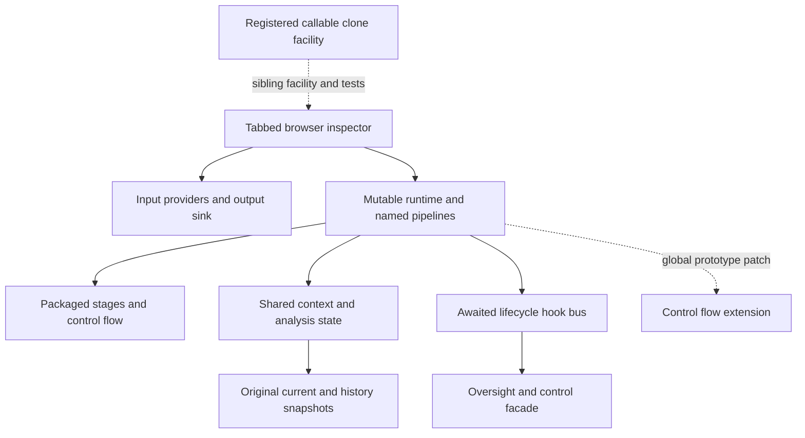

# Selective learning catalogue: stitched pipeline hypervisor

Review date: 2026-10-29 (America/New_York). Approved scope: AUTH-11.

This is a source-learning record for Docstream. Catalogue inclusion is not adoption, validation of the supplied runtime or implementation clearance. All proposed applications remain **not adopted**. The archive was assessed under the user instruction to learn selectively, including lessons, anti-lessons, patterns, antipatterns, structures, edifices and related findings; do not wholesale lift.

## Source, review and authority boundaries

Source: `C:/Users/<local-user>/Downloads/stitched_pipeline_hypervisor_hardened.zip`.

Archive SHA-256: `75e26f23f5b62d3a5379e4fa6c62f1b98382cf8d932df4889f3f3299fe6e3e90`.

The archive contains 17 files and two explicit directory entries, totaling 509,698 uncompressed file bytes. All 17 files were reviewed as source text, including the complete README, supplied result report and self-test assertions. Long JavaScript listings were read with repetitive blank/comment lines omitted. The callable-registry common implementation was reviewed once, then its browser/ESM differences were inspected and shared-body parity checked. No source was evaluated, imported as executable, extracted for execution or opened in a browser. No dependency was installed.

The supplied README describes successive additions through v12.4, while the main title still says v12. Those are source version descriptions, not verified release provenance. The included result report claims 16 passes and has an internal completion timestamp of `2026-04-26T22:22:23.379Z`. This review took place on 2026-10-29. The report does not bind its result to the current archive digest or provide a host/runtime identity. Its claims are retained without being presented as a fresh local run.

Source instructions, examples and self-test commands were read as data. They do not grant authority to execute, adopt or integrate. No separate mining/standardization report was designated; the README and supplied test report were read before catalogue rules were applied. The categories organize this manual review, not a source-derived universal taxonomy or product schema.

Evidence locations refer to files inside the ZIP, relative to `stitched_pipeline_hypervisor/`. Lines are one-based LF splits with terminal CR removed and the final empty line retained. Excerpts are exact substrings in the inclusive line range. `SOURCE_MANIFEST.json` records full source hashes, coverage and validation.

## Evidence and application rules

- **Source claim:** an assertion in the supplied documents/report; not independently verified.
- **Static observation:** directly inspected declarations, branches, assignments or source relationships.
- **Assistant inference:** interpretation or a predicted effect. Runtime failure paths here were not reproduced.
- **Proposed application:** a possible use for Docstream, with assumptions, limitations and required validation.
- **Prior-catalogue link:** a comparison with earlier PP7 learning, not proof that one archive descended from the other.

Current application context remains native AI-originated documents, direct references assembled into words/sentences/paragraphs, retained transformation occurrences, immutable results, CPU first and agentic-control integration last. Reference widths, return semantics, map/version policy, higher-level interning and a native-core migration remain unresolved. The existing Docstream harness findings remain open.

## Review inventory

| ZIP-relative file | Bytes | Lines | Anchors | SHA-256 prefix |
| --- | ---: | ---: | ---: | --- |
| `README.md` | 12759 | 397 | 2 | `4e969aed9cfb5224` |
| `SELF_TEST_RESULT.json` | 5707 | 208 | 2 | `8195fc175ca499b2` |
| `application-ui.js` | 46142 | 794 | 2 | `a482cbfc11ecb9b1` |
| `index.html` | 8780 | 217 | 3 | `37001f564f5c698a` |
| `run-self-tests-node.js` | 545 | 21 | 1 | `c6905e066a031a1b` |
| `self-tests.js` | 49385 | 721 | 3 | `a28bcbc09af76352` |
| `stateful-plugins.js` | 19252 | 347 | 5 | `0e32091b30a51bd2` |
| `stream-plugins.js` | 26002 | 408 | 6 | `4fb74a2649a7d806` |
| `style.css` | 3667 | 235 | 1 | `596ad11d88cd7cf9` |
| `callable-registry/deep_clone_callable_registry_module_hardened.js` | 41475 | 1139 | 16 | `cd7b296ea18077fd` |
| `callable-registry/self_test.mjs` | 182 | 5 | 1 | `41a33bbda4d7aa57` |
| `deep-clone-callable-registry.browser.js` | 41824 | 1151 | 1 | `529c71f78fd27054` |
| `pipeline-hypervisor.js` | 22833 | 545 | 12 | `8aa000f15d31d531` |
| `advanced-flow-data-plugins.js` | 34811 | 850 | 15 | `7f5e03f178f95c98` |
| `browser-adapters.js` | 3760 | 98 | 3 | `88577063116a82ea` |
| `control-flow-plugins.js` | 42776 | 692 | 15 | `5751788957d01cfe` |
| `pipeline-core.js` | 149798 | 2982 | 53 | `b9b23d8efae7a069` |

## Dispositions and working lenses

| Disposition | Records |
| --- | ---: |
| Reference only | 13 |
| Candidate adaptation | 16 |
| Avoid as implemented | 7 |
| Requires validation | 18 |

| Lens | Meaning | Memberships |
| --- | --- | ---: |
| Lesson | A useful principle supported by the source observation. | 16 |
| Anti lesson | A conclusion or guarantee that should not be inferred from this source. | 28 |
| Pattern | A potentially reusable arrangement of responsibilities or behavior. | 7 |
| Antipattern | An arrangement unsuitable under the stated application conditions. | 4 |
| Structure | A concrete component, record, interface or relationship. | 19 |
| Edifice | A larger composition of structures and its operating assumptions. | 6 |
| Mechanism | How a behavior is arranged or carried out. | 20 |
| Invariant | A condition a future application would need to maintain. | 31 |
| Failure mode | A source-observed gap or a specifically labeled predicted failure. | 16 |
| Trade off | A benefit and cost that depend on purpose or environment. | 12 |
| Open question | A question unresolved by this static review. | 4 |

Lens memberships overlap; they are not additional independent findings. Version 2 of the structured catalogue retains the earlier record fields and adds explicit `prior_catalogue_links`. Its schema is a review format, not a new Docstream content schema.

## How the larger composition fits together

This assistant-authored sketch describes static source relationships. It is not an executed trace or adopted Docstream design.



The strongest reusable arrangements are explicit snapshot history, observation outside the processing stage list, state indexed by producer occurrence, common budget accounting and trusted behavior reconstructed from definitions plus state. Each has constraints documented below. Frozen entries do not enforce append-only ownership; observations can block; direct child execution can bypass ordinary accounting; registered behavior is still trusted executable code.

The native reference-and-assembly model remains a separate design. Processor registries and JSON object histories do not define native units, return semantics or immutable map bindings. Signal-driven skipping also differs from the requested logical reduction of reversed/redundant transformations. No bypass, GPU, schema migration or final agentic-control integration is implemented by this catalogue.

## Relationship to the earlier catalogue

There are 70 explicit links to 33 of the 36 previous records. Unlinked records are not declared resolved, disproven or adopted. The earlier catalogue remains unchanged.

| Relationship | Meaning | Links |
| --- | --- | ---: |
| Strengthens | Adds a concrete mechanism relevant to an earlier principle, without proving it complete. | 8 |
| Persists | The earlier limitation remains relevant in this source. | 23 |
| Qualifies | New source requires a narrower or more differentiated statement. | 10 |
| Extends | Adds a related concern or structure. | 29 |

Examples: SHH-001 qualifies the former shared-context finding because frozen document snapshots now coexist with mutable orchestration. SHH-029 qualifies the overlap finding because a guard now exists but setup still precedes its cleanup region. SHH-034 qualifies regex findings with new heuristics/caps while retaining deadline limits. SHH-025 and SHH-035 preserve dependency and scanner concerns. SHH-049 preserves the native-core boundary.

## Record index

| ID | Learning | Disposition |
| --- | --- | --- |
| [SHH-001](#shh-001) | Separate the original, current value and transformation history | Candidate adaptation |
| [SHH-002](#shh-002) | A frozen history array does not make its owning reference append-only | Avoid as implemented |
| [SHH-003](#shh-003) | Validate an entire history append before publishing any part | Avoid as implemented |
| [SHH-004](#shh-004) | Protect reserved metadata and define deep immutability | Requires validation |
| [SHH-005](#shh-005) | Preserved history needs a resource and sharing model | Candidate adaptation |
| [SHH-006](#shh-006) | Document history is reset when the reader initializes a new pass | Reference only |
| [SHH-007](#shh-007) | A no-content-change occurrence need not require another full payload | Candidate adaptation |
| [SHH-008](#shh-008) | Use explicit clone contracts for data and trusted runtime objects | Candidate adaptation |
| [SHH-009](#shh-009) | Array validation must inspect descriptors as well as values | Requires validation |
| [SHH-010](#shh-010) | Validate address segments before traversing inherited containers | Avoid as implemented |
| [SHH-011](#shh-011) | Convenience proxies must preserve host object invariants | Requires validation |
| [SHH-012](#shh-012) | Compatibility methods must state changed behavior | Reference only |
| [SHH-013](#shh-013) | Keep current analysis indexes and a state timeline distinct | Candidate adaptation |
| [SHH-014](#shh-014) | Occurrence keys must include their pipeline and run scope | Requires validation |
| [SHH-015](#shh-015) | Visibility labels do not enforce state disclosure policy | Requires validation |
| [SHH-016](#shh-016) | Analysis tokens still cannot stand in for native content units | Reference only |
| [SHH-017](#shh-017) | Text normalization and falsy-root conversion need declared semantics | Avoid as implemented |
| [SHH-018](#shh-018) | Observe execution outside the processing stage sequence | Candidate adaptation |
| [SHH-019](#shh-019) | Out-of-band observation can still block and alter the pass | Requires validation |
| [SHH-020](#shh-020) | Retained dispatch records must track their actual completion | Avoid as implemented |
| [SHH-021](#shh-021) | Separate observer failure policy from document transaction outcome | Candidate adaptation |
| [SHH-022](#shh-022) | Reserve event identity fields and define summary disclosure | Requires validation |
| [SHH-023](#shh-023) | An observational label does not restrict control authority | Reference only |
| [SHH-024](#shh-024) | Aggregate metrics without discarding invocation identity | Candidate adaptation |
| [SHH-025](#shh-025) | Validate dependencies against the actual named pipeline | Requires validation |
| [SHH-026](#shh-026) | Centralize multi-dimensional pass budgets and report consumption | Candidate adaptation |
| [SHH-027](#shh-027) | A cooperative elapsed check is not an interrupting deadline | Reference only |
| [SHH-028](#shh-028) | Foreach children need the same dispatch and observation contract | Avoid as implemented |
| [SHH-029](#shh-029) | Acquire the pass guard inside a cleanup-protected region | Requires validation |
| [SHH-030](#shh-030) | Pause and reset need a generation and continuation contract | Requires validation |
| [SHH-031](#shh-031) | Nested errors must propagate to the final pass outcome | Requires validation |
| [SHH-032](#shh-032) | Prototype patching makes assembly order part of behavior | Reference only |
| [SHH-033](#shh-033) | Signal-driven skipping is distinct from proven transformation reduction | Reference only |
| [SHH-034](#shh-034) | Regex heuristics and input caps are useful but incomplete bounds | Reference only |
| [SHH-035](#shh-035) | Scanners need coordinate-correct progress and completion labels | Requires validation |
| [SHH-036](#shh-036) | Optional predicate values must survive strict-boundary migration | Requires validation |
| [SHH-037](#shh-037) | Packaged operations and arbitrary callbacks have different authority | Reference only |
| [SHH-038](#shh-038) | Object conversions need explicit key and type-loss rules | Requires validation |
| [SHH-039](#shh-039) | Reconstruct trusted behavior from registered definitions and state | Candidate adaptation |
| [SHH-040](#shh-040) | Duplicate rejection and schema labels do not bind behavior versions | Requires validation |
| [SHH-041](#shh-041) | A declared clone option must actually control its copy paths | Requires validation |
| [SHH-042](#shh-042) | Graph cloning must preserve aliasing as well as cycles | Requires validation |
| [SHH-043](#shh-043) | Cloning a callable reference must not silently change its representation | Requires validation |
| [SHH-044](#shh-044) | Twin entry points require parity checks and honest runner evidence | Candidate adaptation |
| [SHH-045](#shh-045) | Test names must be read against their actual assertions | Candidate adaptation |
| [SHH-046](#shh-046) | Retain supplied results as dated claims with a provenance boundary | Reference only |
| [SHH-047](#shh-047) | Separate human inspection surfaces from document rendering | Candidate adaptation |
| [SHH-048](#shh-048) | Distinguish configured factories, loaded instances and live signals | Candidate adaptation |
| [SHH-049](#shh-049) | A processor registry and JSON history are not the native reference core | Reference only |
| [SHH-050](#shh-050) | Health is a policy over recent evidence, not an attestation | Reference only |
| [SHH-051](#shh-051) | Output assignment, sink success and pass completion are separate events | Avoid as implemented |
| [SHH-052](#shh-052) | Edifice: stitched oversight around a mutable execution system | Reference only |
| [SHH-053](#shh-053) | Equality helpers need a declared semantic domain | Candidate adaptation |
| [SHH-054](#shh-054) | Bound record counts, payload bytes and key cardinality separately | Candidate adaptation |

## Detailed learning records

### SHH-001

**Separate the original, current value and transformation history**

**Lenses:** Lesson, Pattern, Structure, Invariant.
**Disposition:** Candidate adaptation. **Application status:** not adopted.

**Source evidence**

- **Static observation** — `pipeline-core.js:465-488`, `Object.defineProperty(this,"immutableOriginalRoot"`. The constructor separates a non-writable original root from current and history properties.

```text
Object.defineProperty(this,"immutableOriginalRoot"
```

- **Static observation** — `pipeline-core.js:499-514`, `this.jsonHistoryBuffer=Object.freeze(`. The append method stores a new frozen snapshot alongside the prior entries.

```text
this.jsonHistoryBuffer=Object.freeze(
```

**Assistant inference**

This is a closer example of retained intermediate values than the earlier shared-context-only model. It remains an in-memory document wrapper.

**Proposed application**

Consider separate immutable payloads, current-head references and transformation records for the native model.

**Assumptions and limits**

- No durable store, content addressing or reduction proof is supplied by this wrapper.

**Validation needed before a future adaptation**

- Original and intermediate values remain inspectable after later transformations.

**Related records:** [SHH-002](#shh-002) (constrained by); [SHH-003](#shh-003) (constrained by); [SHH-007](#shh-007) (complements).

**Earlier catalogue relationships**

- [PP7-012](../plugin-pipeline-v7/LEARNING_CATALOG.md#pp7-012) — qualifies: Document payload snapshots now coexist with the mutable context.

### SHH-002

**A frozen history array does not make its owning reference append-only**

**Lenses:** Anti lesson, Failure mode, Invariant.
**Disposition:** Avoid as implemented. **Application status:** not adopted.

**Source evidence**

- **Static observation** — `pipeline-core.js:481-488`, `writable:true`. Current/history fields are writable properties.

```text
writable:true
```

- **Static observation** — `pipeline-core.js:1065-1070`, `return Reflect.set(targetDocument,propertyKey,propertyValue);`. The proxy delegates writes to existing wrapper properties.

```text
return Reflect.set(targetDocument,propertyKey,propertyValue);
```

**Assistant inference**

A caller with the live document can replace the history or current-root pointer. Frozen entries alone do not establish an enforced append-only API.

**Proposed application**

Make history ownership and allowed head changes explicit; expose inspection views rather than writable storage fields.

**Assumptions and limits**

- No live pointer-replacement attempt was executed.

**Validation needed before a future adaptation**

- Replacing history/current pointers through every public access path is rejected where append-only behavior is promised.

**Related records:** [SHH-011](#shh-011) (complements).

**Earlier catalogue relationships**

- [PP7-003](../plugin-pipeline-v7/LEARNING_CATALOG.md#pp7-003) — persists: The exact immutability boundary still matters.

### SHH-003

**Validate an entire history append before publishing any part**

**Lenses:** Antipattern, Failure mode, Invariant.
**Disposition:** Avoid as implemented. **Application status:** not adopted.

**Source evidence**

- **Static observation** — `pipeline-core.js:502-513`, `this.currentJsonRoot=frozenNextRoot;`. Current root and history are assigned before metadata cloning.

```text
this.currentJsonRoot=frozenNextRoot;
```

- **Static observation** — `pipeline-core.js:512-513`, `PipelineSecurityUtility.cloneStrictJsonValue(transformationMetadata||{`. Metadata can still fail strict validation after those assignments.

```text
PipelineSecurityUtility.cloneStrictJsonValue(transformationMetadata||{})
```

**Assistant inference**

Invalid metadata is a predicted path to a changed current root/history without a matching metadata append. The method has no local rollback around that order.

**Proposed application**

Prepare and validate the snapshot, metadata and lineage together before publishing one consistent update.

**Assumptions and limits**

- This exception path was not executed.

**Validation needed before a future adaptation**

- Rejected metadata leaves current value, history length and metadata length unchanged.

**Related records:** [SHH-004](#shh-004) (complements); [SHH-051](#shh-051) (complements).

**Earlier catalogue relationships**

- [PP7-025](../plugin-pipeline-v7/LEARNING_CATALOG.md#pp7-025) — extends: Publication consistency applies inside the history append too.

### SHH-004

**Protect reserved metadata and define deep immutability**

**Lenses:** Anti lesson, Structure, Invariant.
**Disposition:** Requires validation. **Application status:** not adopted.

**Source evidence**

- **Static observation** — `pipeline-core.js:473-473`, `...PipelineSecurityUtility.cloneStrictJsonValue(documentMetadata||{})`. Caller metadata is spread after generated index/event/time fields.

```text
...PipelineSecurityUtility.cloneStrictJsonValue(documentMetadata||{})
```

- **Static observation** — `pipeline-core.js:512-513`, `const nextHistoryMetadataRecord=Object.freeze({historyIndex:nextHistor`. Append metadata is shallow-frozen with caller fields spread last.

```text
const nextHistoryMetadataRecord=Object.freeze({historyIndex:nextHistoryIndex
```

**Assistant inference**

Callers can override reserved descriptive fields, and nested metadata is not recursively frozen by the shallow record freeze. Content and its description have different protection.

**Proposed application**

Reserve authoritative identity/order fields and deep-freeze or isolate retained metadata according to a declared contract.

**Assumptions and limits**

- No metadata override or nested mutation was exercised.

**Validation needed before a future adaptation**

- Reserved keys cannot misstate history order; retained nested metadata cannot be mutated through live references.

**Earlier catalogue relationships**

- [PP7-003](../plugin-pipeline-v7/LEARNING_CATALOG.md#pp7-003) — extends: Metadata protection needs its own depth and authority contract.

### SHH-005

**Preserved history needs a resource and sharing model**

**Lenses:** Trade off, Mechanism, Failure mode.
**Disposition:** Candidate adaptation. **Application status:** not adopted.

**Source evidence**

- **Static observation** — `pipeline-core.js:502-513`, `...this.jsonHistoryBuffer`. Every append clones a full root and copies the growing history array.

```text
this.jsonHistoryBuffer=Object.freeze([...(Array.isArray(this.jsonHistoryBuffer)
```

- **Static observation** — `stream-plugins.js:338-346`, `transformedJsonHistory:`. Stream output serializes document history together with other state.

```text
transformedJsonHistory:
```

**Assistant inference**

Snapshot retention supports inspection but implies growing copy and serialization work. Repeated array copying can accumulate quadratic reference-copy work with history length; no benchmark was run.

**Proposed application**

Separate logical occurrence retention from payload storage and artifact retention; measure sharing and storage costs before selecting a representation.

**Assumptions and limits**

- No measured memory or timing estimate is claimed.

**Validation needed before a future adaptation**

- Long histories stay within explicit byte/time budgets while retaining addressable occurrences.

**Related records:** [SHH-054](#shh-054) (complements).

**Earlier catalogue relationships**

- [PP7-024](../plugin-pipeline-v7/LEARNING_CATALOG.md#pp7-024) — extends: New history buffers add another retention dimension.

### SHH-006

**Document history is reset when the reader initializes a new pass**

**Lenses:** Anti lesson, Mechanism, Open question.
**Disposition:** Reference only. **Application status:** not adopted.

**Source evidence**

- **Static observation** — `stream-plugins.js:34-54`, `streamProcessingState.revisions=[];`. Reader initialization replaces both document wrappers and resets revision/analysis state.

```text
streamProcessingState.revisions=[];
```

- **Static observation** — `stream-plugins.js:138-149`, `initializeStreamStateFromJsonData(`. The stream reader initializes this state on each execution.

```text
initializeStreamStateFromJsonData(
```

**Assistant inference**

History is scoped to the current document wrapper, not automatically to all cycles of the running service. Re-reading a source starts new wrappers.

**Proposed application**

Specify source ingestion, new-run creation and continuing transformation history as separate operations.

**Assumptions and limits**

- A reader may intentionally start a fresh document; the issue is the declared lifetime.

**Validation needed before a future adaptation**

- A sequence spanning requests retains the intended lineage rather than silently restarting it.

**Related records:** [SHH-001](#shh-001) (contrasts with).

**Earlier catalogue relationships**

- [PP7-021](../plugin-pipeline-v7/LEARNING_CATALOG.md#pp7-021) — extends: Repeated passes and their input lifetimes need explicit meaning.

### SHH-007

**A no-content-change occurrence need not require another full payload**

**Lenses:** Lesson, Trade off, Mechanism.
**Disposition:** Candidate adaptation. **Application status:** not adopted.

**Source evidence**

- **Static observation** — `stream-plugins.js:262-268`, `replaceTransformedStreamJsonDocument(pipelineContext,currentTransforme`. The stream dummy appends a transformation snapshot even when content is preserved.

```text
replaceTransformedStreamJsonDocument(pipelineContext,currentTransformedPlainJson
```

- **Static observation** — `stateful-plugins.js:207-214`, `dataMutation:false`. The stateful dummy records diagnostics without the stream snapshot operation.

```text
dataMutation:false
```

**Assistant inference**

The two dummy modes distinguish content preservation from the cost of recording it. The source does not deduplicate equal payloads or prove eliminated execution.

**Proposed application**

Retain requested no-op occurrences and reasons while allowing equal payload/artifact reuse under the native service contract.

**Assumptions and limits**

- Equal content does not establish equal provenance or presentation profile.

**Validation needed before a future adaptation**

- No-op occurrences remain distinguishable while unnecessary payload copies and rendering can be avoided.

**Related records:** [SHH-053](#shh-053) (depends on).

**Earlier catalogue relationships**

- [PP7-036](../plugin-pipeline-v7/LEARNING_CATALOG.md#pp7-036) — strengthens: The source explicitly records a stream revision for unchanged content.

### SHH-008

**Use explicit clone contracts for data and trusted runtime objects**

**Lenses:** Lesson, Pattern, Structure.
**Disposition:** Candidate adaptation. **Application status:** not adopted.

**Source evidence**

- **Static observation** — `pipeline-core.js:23-49`, `return PipelineSecurityUtility.cloneRuntimeSafeValue(valueToClone);`. The compatibility alias retains runtime-object cloning semantics.

```text
return PipelineSecurityUtility.cloneRuntimeSafeValue(valueToClone);
```

- **Static observation** — `pipeline-core.js:106-138`, `PipelineSecurityUtility.isPlainObject(valueToClone)`. The strict path requires plain objects and checks their own descriptors.

```text
PipelineSecurityUtility.isPlainObject(valueToClone)
```

**Assistant inference**

Splitting strict data cloning from runtime-object cloning is useful. The legacy JsonSafe name no longer communicates the stricter contract.

**Proposed application**

Use named, versioned data boundaries; keep executable/runtime objects outside native content records.

**Assumptions and limits**

- The strict contract intentionally rejects some ordinary JSON object keys such as constructor.

**Validation needed before a future adaptation**

- Every call site selects the intended contract; valid-domain exclusions are documented.

**Related records:** [SHH-009](#shh-009) (constrained by); [SHH-036](#shh-036) (constrained by).

**Earlier catalogue relationships**

- [PP7-028](../plugin-pipeline-v7/LEARNING_CATALOG.md#pp7-028) — strengthens: Strict data cloning is now separate from general runtime cloning.

### SHH-009

**Array validation must inspect descriptors as well as values**

**Lenses:** Anti lesson, Failure mode, Invariant.
**Disposition:** Requires validation. **Application status:** not adopted.

**Source evidence**

- **Static observation** — `pipeline-core.js:90-104`, `valueToClone[arrayItemIndex]`. Strict cloning reads array slots directly and returns without inspecting extra own properties.

```text
valueToClone[arrayItemIndex]
```

- **Static observation** — `pipeline-core.js:124-134`, `uses an accessor descriptor`. The plain-object branch explicitly rejects accessors, unlike that array loop.

```text
uses an accessor descriptor
```

**Assistant inference**

An accessor on an array index can be invoked, and extra array properties are not checked by this branch. The README descriptor-rejection claim is broader than these inspected checks.

**Proposed application**

Define dense array slots, allowed own keys and descriptor behavior at the native data boundary.

**Assumptions and limits**

- No getter was invoked during this review; arbitrary Proxy objects need separate consideration too.

**Validation needed before a future adaptation**

- Array accessors, symbol/extra keys and non-enumerable slots are accepted or rejected consistently without unintended evaluation.

**Related records:** [SHH-041](#shh-041) (complements).

**Earlier catalogue relationships**

- [PP7-028](../plugin-pipeline-v7/LEARNING_CATALOG.md#pp7-028) — qualifies: Stricter object checks do not cover every array shape.

### SHH-010

**Validate address segments before traversing inherited containers**

**Lenses:** Antipattern, Failure mode, Invariant.
**Disposition:** Avoid as implemented. **Application status:** not adopted.

**Source evidence**

- **Static observation** — `pipeline-core.js:1013-1033`, `.split(".")`. The path converter does not reject prototype-related segments.

```text
.split(".")
```

- **Static observation** — `pipeline-core.js:655-678`, `currentCursor=currentCursor[currentPathPart];`. The setter traverses indexed containers and assigns before cloning the final root.

```text
currentCursor=currentCursor[currentPathPart];
```

- **Static observation** — `pipeline-core.js:754-767`, `targetObject=targetObject[jsonPathPart];`. Merge traversal also uses inherited property lookup.

```text
targetObject=targetObject[jsonPathPart];
```

**Assistant inference**

Blocked keys in the final JSON clone do not by themselves protect path traversal. Traversing an inherited prototype container and writing into it is a predicted mutation path before final validation.

**Proposed application**

Use a defined address grammar, own-property traversal and reserved-segment checks before any write.

**Assumptions and limits**

- No prototype mutation or exploit was executed; this is a source-traced concern.

**Validation needed before a future adaptation**

- Reserved/inherited path segments cannot modify shared prototypes; failed writes leave all owned and shared state unchanged.

**Related records:** [SHH-008](#shh-008) (depends on).

**Earlier catalogue relationships**

- [PP7-015](../plugin-pipeline-v7/LEARNING_CATALOG.md#pp7-015) — extends: Coordinates also need a safe address-resolution contract.

### SHH-011

**Convenience proxies must preserve host object invariants**

**Lenses:** Anti lesson, Structure, Failure mode.
**Disposition:** Requires validation. **Application status:** not adopted.

**Source evidence**

- **Static observation** — `pipeline-core.js:476-494`, `configurable:false`. The wrapper defines non-configurable own properties.

```text
configurable:false
```

- **Static observation** — `pipeline-core.js:1094-1100`, `return Reflect.ownKeys(targetDocument.currentJsonRoot);`. The proxy ownKeys result uses document-root keys instead of all target keys.

```text
return Reflect.ownKeys(targetDocument.currentJsonRoot);
```

**Assistant inference**

Omitting non-configurable target keys is a predicted JavaScript Proxy invariant violation for enumeration. Forwarding document fields also collides with wrapper member names.

**Proposed application**

Prefer explicit native data accessors or validate every reflection operation if a transparent wrapper is retained.

**Assumptions and limits**

- Object.keys and related reflection operations were not run.

**Validation needed before a future adaptation**

- Enumeration, serialization, member collisions and descriptor queries satisfy the wrapper contract.

**Related records:** [SHH-002](#shh-002) (complements).

**Earlier catalogue relationships**

- [PP7-028](../plugin-pipeline-v7/LEARNING_CATALOG.md#pp7-028) — extends: A clone/data wrapper must also obey its host runtime invariants.

### SHH-012

**Compatibility methods must state changed behavior**

**Lenses:** Anti lesson, Trade off, Mechanism.
**Disposition:** Reference only. **Application status:** not adopted.

**Source evidence**

- **Static observation** — `pipeline-core.js:558-570`, `alsoReplaceOriginalRootIgnored:Boolean(alsoReplaceOriginalRoot)`. A former replacement flag becomes metadata; commitCurrentRootAsOriginalRoot returns without changing state.

```text
alsoReplaceOriginalRootIgnored:Boolean(alsoReplaceOriginalRoot)
```

**Assistant inference**

Retaining an API name while changing its effect can conceal a compatibility break, even when preserving the original root is desirable.

**Proposed application**

Use explicit deprecation/outcome records for operations whose old names imply a different effect.

**Assumptions and limits**

- The archive does not document every historical caller expectation.

**Validation needed before a future adaptation**

- Callers receive a clear result for unsupported legacy effects and cannot infer a commit from a method name.

**Related records:** [SHH-030](#shh-030) (complements).

**Earlier catalogue relationships**

- [PP7-026](../plugin-pipeline-v7/LEARNING_CATALOG.md#pp7-026) — extends: Truthful outcomes include compatibility behavior.

### SHH-013

**Keep current analysis indexes and a state timeline distinct**

**Lenses:** Lesson, Pattern, Structure.
**Disposition:** Candidate adaptation. **Application status:** not adopted.

**Source evidence**

- **Static observation** — `pipeline-core.js:1270-1292`, `genericStateContainer.timeline.push(pluginStateRecord);`. Generic state stores current per-instance namespace entries plus per-type history and a timeline.

```text
genericStateContainer.timeline.push(pluginStateRecord);
```

- **Static observation** — `pipeline-core.js:1363-1375`, `includeTypeHistory`. Output snapshot policy can omit type history or timeline.

```text
includeTypeHistory
```

**Assistant inference**

This separates current lookup from historical occurrences and reduces output hardwiring to particular analysis plugins.

**Proposed application**

Consider derived analysis records keyed to stream, producer occurrence, analysis kind and definition version.

**Assumptions and limits**

- The source records mutable shared objects rather than an immutable persistent analysis store.

**Validation needed before a future adaptation**

- Current and historical reads select the intended stream/producer and preserve older analysis values.

**Related records:** [SHH-014](#shh-014) (constrained by); [SHH-015](#shh-015) (constrained by).

**Earlier catalogue relationships**

- [PP7-020](../plugin-pipeline-v7/LEARNING_CATALOG.md#pp7-020) — strengthens: Generic per-instance analysis namespaces extend occurrence-keyed state.

### SHH-014

**Occurrence keys must include their pipeline and run scope**

**Lenses:** Failure mode, Invariant, Structure.
**Disposition:** Requires validation. **Application status:** not adopted.

**Source evidence**

- **Static observation** — `pipeline-core.js:2395-2398`, `this.pluginInstanceCounter+=1;`. Each plugin manager uses its own local instance counter.

```text
this.pluginInstanceCounter+=1;
```

- **Static observation** — `control-flow-plugins.js:93-94`, `new PluginManager(pipelineRuntime.debug,pipelineRuntime.registry)`. Named pipelines have separate managers but share runtime context.

```text
new PluginManager(pipelineRuntime.debug,pipelineRuntime.registry)
```

- **Static observation** — `pipeline-core.js:1281-1289`, `genericStateContainer.byInstanceId[ownerInstanceId]`. Generic state is indexed by instance ID without a pipeline field.

```text
genericStateContainer.byInstanceId[ownerInstanceId]
```

**Assistant inference**

Identical type/counter IDs from separate managers can collide in the shared state bucket. Local uniqueness is narrower than invocation identity.

**Proposed application**

Define producer identity with pipeline, instance, invocation and source-stream scope where required.

**Assumptions and limits**

- The collision sequence was not executed.

**Validation needed before a future adaptation**

- Same-type first instances in different named pipelines retain separate state and traces.

**Related records:** [SHH-024](#shh-024) (complements).

**Earlier catalogue relationships**

- [PP7-001](../plugin-pipeline-v7/LEARNING_CATALOG.md#pp7-001) — extends: Occurrence identity needs a wider scope in a multi-pipeline composition.

### SHH-015

**Visibility labels do not enforce state disclosure policy**

**Lenses:** Anti lesson, Invariant, Structure.
**Disposition:** Requires validation. **Application status:** not adopted.

**Source evidence**

- **Static observation** — `pipeline-core.js:1260-1278`, `visibility:stateVisibility`. State records carry a visibility label.

```text
visibility:stateVisibility
```

- **Static observation** — `pipeline-core.js:1371-1375`, `byInstanceId:PipelineSecurityUtility.cloneStrictJsonValue`. Snapshot creation clones every instance bucket without filtering visibility.

```text
byInstanceId:PipelineSecurityUtility.cloneStrictJsonValue
```

**Assistant inference**

A descriptive visibility field is not an access or redaction mechanism. Output consumers need a separate disclosure contract.

**Proposed application**

Specify which analysis and metadata fields may enter caller results, debug views and observation summaries.

**Assumptions and limits**

- No claim is made that the archive is a multi-user service.

**Validation needed before a future adaptation**

- Non-public state is excluded from each restricted output surface under explicit policy.

**Related records:** [SHH-022](#shh-022) (complements).

**Earlier catalogue relationships**

- [PP7-029](../plugin-pipeline-v7/LEARNING_CATALOG.md#pp7-029) — extends: Metadata labels do not isolate authority or disclosure.

### SHH-016

**Analysis tokens still cannot stand in for native content units**

**Lenses:** Anti lesson, Mechanism, Invariant.
**Disposition:** Reference only. **Application status:** not adopted.

**Source evidence**

- **Static observation** — `pipeline-core.js:1127-1161`, `const tokenScanningRegularExpression=/\b[\p{L}\p{N}_'-]+\b|[^\s]/gu;`. The scanner omits whitespace, uses string indices/lengths and lowercases frequency keys.

```text
const tokenScanningRegularExpression=/\b[\p{L}\p{N}_'-]+\b|[^\s]/gu;
```

- **Static observation** — `pipeline-core.js:1151-1158`, `const tokenFrequencyByLowerCaseValue={};`. Frequency storage remains an ordinary object.

```text
const tokenFrequencyByLowerCaseValue={};
```

**Assistant inference**

Whitespace/return preservation, UTF-16 coordinate meaning and casefolded derived statistics remain separate concerns from a lossless native reference sequence.

**Proposed application**

Keep tokenization optional and derived; define native units, returns, coordinates and map versions independently.

**Assumptions and limits**

- Original text still exists outside the token list; no Unicode cases were run.

**Validation needed before a future adaptation**

- Native round trips preserve all units; analysis coordinates and key domains are explicit.

**Related records:** [SHH-017](#shh-017) (complements); [SHH-049](#shh-049) (constrained by).

**Earlier catalogue relationships**

- [PP7-013](../plugin-pipeline-v7/LEARNING_CATALOG.md#pp7-013) — persists: The tokenizer remains an analysis view.
- [PP7-015](../plugin-pipeline-v7/LEARNING_CATALOG.md#pp7-015) — persists: Index units are still not a native address schema.
- [PP7-016](../plugin-pipeline-v7/LEARNING_CATALOG.md#pp7-016) — persists: Frequency keys still use case folding and ordinary object storage.

### SHH-017

**Text normalization and falsy-root conversion need declared semantics**

**Lenses:** Anti lesson, Mechanism, Invariant.
**Disposition:** Avoid as implemented. **Application status:** not adopted.

**Source evidence**

- **Static observation** — `pipeline-core.js:389-403`, `const trimmedInputText=inputText.trim();`. Non-JSON fallback returns trimmed text.

```text
const trimmedInputText=inputText.trim();
```

- **Static observation** — `pipeline-core.js:1383-1383`, `pipelineContext.data||{}`. Context wrapping substitutes an object for a falsy root.

```text
pipelineContext.data||{}
```

- **Static observation** — `stream-plugins.js:114-120`, `JSON.stringify(jsonCompatibleValue||{},null,2)`. Stream source-text fallback also substitutes for falsy roots.

```text
JSON.stringify(jsonCompatibleValue||{},null,2)
```

**Assistant inference**

Strict JSON scalar support is inconsistent with later truthiness defaults, and source text can lose boundary whitespace.

**Proposed application**

Preserve the native source units exactly and distinguish missing values from null, false, zero and empty strings.

**Assumptions and limits**

- These paths have not been run against a scalar corpus.

**Validation needed before a future adaptation**

- Whitespace and every valid scalar receive a documented consistent treatment at all boundaries.

**Related records:** [SHH-036](#shh-036) (complements).

**Earlier catalogue relationships**

- [PP7-014](../plugin-pipeline-v7/LEARNING_CATALOG.md#pp7-014) — persists: Trimming remains in input normalization.
- [PP7-017](../plugin-pipeline-v7/LEARNING_CATALOG.md#pp7-017) — persists: Truthiness defaults still collapse valid values.

### SHH-018

**Observe execution outside the processing stage sequence**

**Lenses:** Lesson, Pattern, Edifice.
**Disposition:** Candidate adaptation. **Application status:** not adopted.

**Source evidence**

- **Static observation** — `pipeline-core.js:1596-1600`, `PipelineSecurityUtility.cloneStrictJsonValue(hookEventPayload)`. Hook envelopes are cloned and frozen before dispatch.

```text
PipelineSecurityUtility.cloneStrictJsonValue(hookEventPayload)
```

- **Static observation** — `pipeline-hypervisor.js:181-207`, `this.runtime.pipelineExecutionHookBus.registerPipelineExecutionHook({`. The hypervisor subscribes to lifecycle hooks instead of loading as a processing node.

```text
this.runtime.pipelineExecutionHookBus.registerPipelineExecutionHook({
```

**Assistant inference**

An observation interface can avoid adding document transformations solely to collect telemetry. It still participates in the same process and execution path.

**Proposed application**

Consider a versioned observation interface around validated transformation/commit events.

**Assumptions and limits**

- This is architectural observation, not CPU virtualization or an isolated security monitor.

**Validation needed before a future adaptation**

- Observers cannot rewrite authoritative content through their supplied event values.

**Related records:** [SHH-019](#shh-019) (constrained by); [SHH-020](#shh-020) (constrained by); [SHH-023](#shh-023) (complements).

**Earlier catalogue relationships**

- [PP7-030](../plugin-pipeline-v7/LEARNING_CATALOG.md#pp7-030) — strengthens: The source now provides an explicit observation layer.

### SHH-019

**Out-of-band observation can still block and alter the pass**

**Lenses:** Anti lesson, Trade off, Mechanism.
**Disposition:** Requires validation. **Application status:** not adopted.

**Source evidence**

- **Static observation** — `pipeline-core.js:1964-1975`, `await hookCallbackReturnValue;`. Callbacks execute serially and returned promises are awaited.

```text
await hookCallbackReturnValue;
```

- **Static observation** — `pipeline-core.js:1629-1633`, `hookExecutionMode`. Registration accepts execution mode metadata; dispatch has no corresponding mode branch.

```text
hookExecutionMode
```

**Assistant inference**

An observer is outside the stage list but still on the execution path. The advertised synchronous/asynchronous label does not select separate scheduling, and a never-settling callback has no dispatch deadline here.

**Proposed application**

Define observer scheduling, bounded work, failure and cancellation independently from content transformation.

**Assumptions and limits**

- No slow or non-settling hook was executed.

**Validation needed before a future adaptation**

- Hook deadlines and ordering are enforced; observation cost cannot indefinitely hold a pass.

**Related records:** [SHH-027](#shh-027) (complements).

**Earlier catalogue relationships**

- [PP7-018](../plugin-pipeline-v7/LEARNING_CATALOG.md#pp7-018) — extends: Observation callbacks add another unbounded evaluation path.

### SHH-020

**Retained dispatch records must track their actual completion**

**Lenses:** Failure mode, Invariant, Structure.
**Disposition:** Avoid as implemented. **Application status:** not adopted.

**Source evidence**

- **Static observation** — `pipeline-core.js:1957-1959`, `this.appendRetainedHookDispatchRecord(hookDispatchRecord);`. A dispatch record is retained before callbacks run.

```text
this.appendRetainedHookDispatchRecord(hookDispatchRecord);
```

- **Static observation** — `pipeline-core.js:2007-2010`, `hookDispatchRecord.completedAt=new Date().toISOString();`. Completion updates the local record.

```text
hookDispatchRecord.completedAt=new Date().toISOString();
```

- **Static observation** — `pipeline-core.js:2036-2038`, `PipelineSecurityUtility.cloneStrictJsonValue(hookDispatchRecord)`. Retention stores a clone rather than the same record.

```text
PipelineSecurityUtility.cloneStrictJsonValue(hookDispatchRecord)
```

**Assistant inference**

The retained clone is not updated by later local counter/completion changes. A snapshot can therefore describe a completed dispatch as unfinished with zero outcomes.

**Proposed application**

Use explicit started/completed events or replace a retained record by identity at completion.

**Assumptions and limits**

- No live hook snapshot was collected.

**Validation needed before a future adaptation**

- Returned and retained dispatch outcomes agree after success and each failure policy.

**Related records:** [SHH-050](#shh-050) (complements).

**Earlier catalogue relationships**

- [PP7-025](../plugin-pipeline-v7/LEARNING_CATALOG.md#pp7-025) — extends: Evidence consistency applies to dispatch journals too.

### SHH-021

**Separate observer failure policy from document transaction outcome**

**Lenses:** Lesson, Trade off, Invariant.
**Disposition:** Candidate adaptation. **Application status:** not adopted.

**Source evidence**

- **Static observation** — `pipeline-core.js:1551-1554`, `FAIL_PIPELINE_EXECUTION:"fail-pipeline-execution"`. Hook policies distinguish continuation, disablement and pass failure.

```text
FAIL_PIPELINE_EXECUTION:"fail-pipeline-execution"
```

- **Static observation** — `pipeline-core.js:1992-2001`, `throw hookCallbackError;`. Fail-pipeline policy propagates an observer exception after recording it.

```text
throw hookCallbackError;
```

**Assistant inference**

Explicit failure policy is useful, but a failed observer may run after content or output effects. Propagating an exception alone does not roll back those effects.

**Proposed application**

Classify mandatory validation, optional telemetry and publication acknowledgements separately, with truthful transaction outcomes.

**Assumptions and limits**

- The source provides no transaction rollback for arbitrary plugin or sink effects.

**Validation needed before a future adaptation**

- Observer failures before and after publication produce documented state and retry behavior.

**Related records:** [SHH-051](#shh-051) (constrained by).

**Earlier catalogue relationships**

- [PP7-025](../plugin-pipeline-v7/LEARNING_CATALOG.md#pp7-025) — extends: Failure policy must be aligned with publication.
- [PP7-027](../plugin-pipeline-v7/LEARNING_CATALOG.md#pp7-027) — extends: Telemetry success and authoritative completion are distinct.

### SHH-022

**Reserve event identity fields and define summary disclosure**

**Lenses:** Invariant, Anti lesson, Structure.
**Disposition:** Requires validation. **Application status:** not adopted.

**Source evidence**

- **Static observation** — `pipeline-core.js:1951-1955`, `...hookEventPayload`. Caller payload is spread after generated event identity, phase and creation time.

```text
...hookEventPayload
```

- **Static observation** — `pipeline-core.js:1712-1715`, `Object.keys(currentDataPlainObject).slice(0,50)`. A summary includes up to 50 top-level data keys.

```text
Object.keys(currentDataPlainObject).slice(0,50)
```

- **Static observation** — `pipeline-core.js:1762-1763`, `createSafeErrorSummary(pipelineExecutionError)`. Failure payloads include error summaries, whose helper retains stack text.

```text
createSafeErrorSummary(pipelineExecutionError)
```

**Assistant inference**

Frozen envelopes can still contain caller-overridden reserved fields; compact summaries and stack text are not a complete disclosure policy.

**Proposed application**

Define reserved event fields, redaction rules and bounded summaries as part of the event schema.

**Assumptions and limits**

- Callbacks are trusted in-process code; this does not claim a demonstrated exfiltration path.

**Validation needed before a future adaptation**

- Payload callers cannot override event identity; sensitive names and errors follow explicit disclosure rules.

**Related records:** [SHH-004](#shh-004) (complements).

**Earlier catalogue relationships**

- [PP7-027](../plugin-pipeline-v7/LEARNING_CATALOG.md#pp7-027) — extends: Event identity and redaction need more than timestamps/freeze.

### SHH-023

**An observational label does not restrict control authority**

**Lenses:** Anti lesson, Edifice, Invariant.
**Disposition:** Reference only. **Application status:** not adopted.

**Source evidence**

- **Static observation** — `pipeline-hypervisor.js:99-100`, `this.mode="observational";`. The hypervisor labels its mode observational.

```text
this.mode="observational";
```

- **Static observation** — `pipeline-hypervisor.js:507-522`, `return this.runtime.signal(signalName);`. Its public methods can send runtime signals and request execution.

```text
return this.runtime.signal(signalName);
```

**Assistant inference**

This component combines observation and a control facade. It is not an isolated monitor or proof of authority separation.

**Proposed application**

Keep observation capabilities, execution requests and approval authority explicit when agentic integration is eventually designed.

**Assumptions and limits**

- No agentic control is integrated by this review; that remains last.

**Validation needed before a future adaptation**

- A read-only consumer cannot acquire control merely through its inspection object.

**Related records:** [SHH-050](#shh-050) (constrained by).

**Earlier catalogue relationships**

- [PP7-029](../plugin-pipeline-v7/LEARNING_CATALOG.md#pp7-029) — persists: Names and categories do not confine execution authority.

### SHH-024

**Aggregate metrics without discarding invocation identity**

**Lenses:** Lesson, Structure, Trade off.
**Disposition:** Candidate adaptation. **Application status:** not adopted.

**Source evidence**

- **Static observation** — `pipeline-hypervisor.js:227-243`, `moduleInstanceId:eventPayload`. Recent event records retain pipeline/module identity but omit run/cycle and a separate invocation key.

```text
moduleInstanceId:eventPayload
```

- **Static observation** — `pipeline-hypervisor.js:277-295`, `this.moduleTimingByTypeId[moduleTypeId]`. Timing and failure counters aggregate by module type.

```text
this.moduleTimingByTypeId[moduleTypeId]
```

**Assistant inference**

Type-level summaries are useful but cannot answer which repeated or nested invocation caused an observation once detailed events are evicted.

**Proposed application**

Retain trace identity separately from aggregate statistics; choose the required run/pipeline/instance/invocation coordinates.

**Assumptions and limits**

- The source does not promise a durable tracing system.

**Validation needed before a future adaptation**

- Repeated nested invocations can be correlated with their start, finish, error and stream result.

**Related records:** [SHH-014](#shh-014) (complements).

**Earlier catalogue relationships**

- [PP7-001](../plugin-pipeline-v7/LEARNING_CATALOG.md#pp7-001) — extends: Processing occurrences need trace-level identity.
- [PP7-027](../plugin-pipeline-v7/LEARNING_CATALOG.md#pp7-027) — extends: Aggregate telemetry has a specific evidence boundary.

### SHH-025

**Validate dependencies against the actual named pipeline**

**Lenses:** Anti lesson, Failure mode, Invariant.
**Disposition:** Requires validation. **Application status:** not adopted.

**Source evidence**

- **Static observation** — `control-flow-plugins.js:190-201`, `this.validateExecutablePipelineNodes(executablePipelineNodes);`. Named-pipeline construction calls the shared validator.

```text
this.validateExecutablePipelineNodes(executablePipelineNodes);
```

- **Static observation** — `pipeline-core.js:2740-2744`, `this.pluginManager.getDependencyWarnings();`. That validator reads the primary manager warnings.

```text
this.pluginManager.getDependencyWarnings();
```

- **Static observation** — `pipeline-core.js:2345-2355`, `loadedPluginTypeIds.indexOf(loadedPluginRecord.plugin.typeId)`. Order checks still compare first type occurrences and return warnings.

```text
loadedPluginTypeIds.indexOf(loadedPluginRecord.plugin.typeId)
```

**Assistant inference**

Structural node checks see the branch nodes, while dependency warning collection still targets the primary manager. Repeated-type and warning-only limitations also remain.

**Proposed application**

Resolve dependencies for the actual execution plan and producer occurrence, using explicit errors or warnings by contract.

**Assumptions and limits**

- No invalid secondary pipeline was executed.

**Validation needed before a future adaptation**

- Invalid secondary dependencies and repeated consumer instances are assessed against their own plan.

**Related records:** [SHH-048](#shh-048) (complements).

**Earlier catalogue relationships**

- [PP7-007](../plugin-pipeline-v7/LEARNING_CATALOG.md#pp7-007) — persists: Warnings are still not execution preconditions.
- [PP7-008](../plugin-pipeline-v7/LEARNING_CATALOG.md#pp7-008) — persists: First-type index comparisons remain.

### SHH-026

**Centralize multi-dimensional pass budgets and report consumption**

**Lenses:** Lesson, Pattern, Mechanism.
**Disposition:** Candidate adaptation. **Application status:** not adopted.

**Source evidence**

- **Static observation** — `pipeline-core.js:2619-2627`, `nodesExecuted:0,branchEntries:0`. Each pass initializes a budget state and exposes a snapshot.

```text
nodesExecuted:0,branchEntries:0
```

- **Static observation** — `pipeline-core.js:2641-2681`, `this.throwExecutionBudgetExceeded("maximumBranchEntriesPerPass"`. Node and branch consumption use named budget-error reasons.

```text
this.throwExecutionBudgetExceeded("maximumBranchEntriesPerPass"
```

- **Static observation** — `control-flow-plugins.js:312-319`, `this.recordBranchEntryAgainstBudget(`. Named-pipeline entry consumes the shared pass branch budget.

```text
this.recordBranchEntryAgainstBudget(
```

**Assistant inference**

A common budget account is stronger than independent ad hoc caps and supplies useful error context. Its coverage depends on all execution paths participating.

**Proposed application**

Consider operation, branch, allocation, output and time budgets with explicit scopes and structured outcomes.

**Assumptions and limits**

- Source defaults are not recommended production values or measured limits.

**Validation needed before a future adaptation**

- Every supported dispatch path consumes the correct account and reports the exhausted dimension.

**Related records:** [SHH-027](#shh-027) (constrained by); [SHH-028](#shh-028) (constrained by).

**Earlier catalogue relationships**

- [PP7-024](../plugin-pipeline-v7/LEARNING_CATALOG.md#pp7-024) — strengthens: The source adds explicit per-pass execution accounting.

### SHH-027

**A cooperative elapsed check is not an interrupting deadline**

**Lenses:** Anti lesson, Mechanism, Invariant.
**Disposition:** Reference only. **Application status:** not adopted.

**Source evidence**

- **Static observation** — `pipeline-core.js:2646-2655`, `const elapsedMilliseconds=Date.now()-this.currentExecutionBudgetState.`. Elapsed time is checked when accounting for another node.

```text
const elapsedMilliseconds=Date.now()-this.currentExecutionBudgetState.startedAtMilliseconds;
```

- **Static observation** — `control-flow-plugins.js:355-361`, `await currentPipelineNode.execute(pipelineContext,this);`. Node execution and hook callbacks run between accounting points.

```text
await currentPipelineNode.execute(pipelineContext,this);
```

**Assistant inference**

A synchronous long node or unresolved promise can exceed the time limit before another check occurs. Node count, input caps and elapsed checks bound different resources.

**Proposed application**

Separate cooperative limits from externally enforced worker deadlines where a bounded response is required.

**Assumptions and limits**

- No blocking workload or timeout was run.

**Validation needed before a future adaptation**

- A deliberately stalled operation is terminated or classified within the declared deadline and recovery policy.

**Related records:** [SHH-034](#shh-034) (complements).

**Earlier catalogue relationships**

- [PP7-018](../plugin-pipeline-v7/LEARNING_CATALOG.md#pp7-018) — persists: A surrounding counter still cannot interrupt one evaluation.

### SHH-028

**Foreach children need the same dispatch and observation contract**

**Lenses:** Antipattern, Failure mode, Mechanism.
**Disposition:** Avoid as implemented. **Application status:** not adopted.

**Source evidence**

- **Static observation** — `advanced-flow-data-plugins.js:695-705`, `await childPlugin.execute(childContext,pipelineRuntime);`. The foreach runner calls a child plugin directly instead of the ordinary node dispatcher.

```text
await childPlugin.execute(childContext,pipelineRuntime);
```

- **Static observation** — `advanced-flow-data-plugins.js:630-636`, `this.itemMapper(inputItem,`. Function mapping also loops internally inside one node.

```text
this.itemMapper(inputItem,
```

**Assistant inference**

Child plugin invocations do not automatically receive ordinary node budget consumption or per-child lifecycle hooks. Item limits help but are a separate bound; passing the same runtime also exposes parent state.

**Proposed application**

Route nested work through an explicit child-dispatch interface that carries budgets, identity, state and observation policy.

**Assumptions and limits**

- No child budget bypass or mutation was exercised; plugins may explicitly consume budgets themselves.

**Validation needed before a future adaptation**

- Nested invocations have complete accounting and cannot accidentally operate on parent context/control state.

**Related records:** [SHH-037](#shh-037) (complements).

**Earlier catalogue relationships**

- [PP7-024](../plugin-pipeline-v7/LEARNING_CATALOG.md#pp7-024) — extends: Coverage must include internal child work.
- [PP7-029](../plugin-pipeline-v7/LEARNING_CATALOG.md#pp7-029) — persists: A child-context wrapper is not execution containment.

### SHH-029

**Acquire the pass guard inside a cleanup-protected region**

**Lenses:** Lesson, Failure mode, Invariant.
**Disposition:** Requires validation. **Application status:** not adopted.

**Source evidence**

- **Static observation** — `control-flow-plugins.js:423-443`, `this.isPipelinePassRunning=true;`. A pass guard is now set before building executable nodes.

```text
this.isPipelinePassRunning=true;
```

- **Static observation** — `control-flow-plugins.js:443-472`, `const executablePipelineNodes=this.buildExecutablePipelineNodes();`. Construction occurs before try/finally; finally normally clears the guard.

```text
const executablePipelineNodes=this.buildExecutablePipelineNodes();
```

**Assistant inference**

The guard addresses overlapping passes but a synchronous build/validation exception before try can leave it set. The improvement and its uncovered exit path must both be retained.

**Proposed application**

Protect guard acquisition, plan validation and cleanup as one lifecycle; return an explicit busy outcome for overlapping requests.

**Assumptions and limits**

- No overlapping or build-failure call was run.

**Validation needed before a future adaptation**

- Every setup failure releases the guard; concurrent requests get a truthful outcome.

**Related records:** [SHH-030](#shh-030) (complements).

**Earlier catalogue relationships**

- [PP7-022](../plugin-pipeline-v7/LEARNING_CATALOG.md#pp7-022) — qualifies: A single-flight guard now exists, but its setup region has a gap.

### SHH-030

**Pause and reset need a generation and continuation contract**

**Lenses:** Open question, Invariant, Mechanism.
**Disposition:** Requires validation. **Application status:** not adopted.

**Source evidence**

- **Static observation** — `control-flow-plugins.js:330-331`, `this.state===RuntimeState.PAUSED`. Traversal returns its context at pause/stop.

```text
this.state===RuntimeState.PAUSED
```

- **Static observation** — `control-flow-plugins.js:451-458`, `this.state!==RuntimeState.PAUSED`. The patched completion path preserves PAUSED.

```text
this.state!==RuntimeState.PAUSED
```

- **Static observation** — `pipeline-core.js:2924-2930`, `this.context=this.createFreshPipelineContext();`. Reset replaces the context without a generation token.

```text
this.context=this.createFreshPipelineContext();
```

**Assistant inference**

Pause preservation is improved over the base run method, but runOnce builds from the start rather than a saved continuation. Reset during an awaited node still needs a stale-completion policy.

**Proposed application**

Specify restart versus resume, frozen input/configuration, cancellation generation and late-result rejection.

**Assumptions and limits**

- Resume/reset timing cases were not reproduced; the supplied pause test only checks stopping before output.

**Validation needed before a future adaptation**

- Pause/resume avoids accidental repeated effects; reset prevents old completions from replacing the new context.

**Related records:** [SHH-031](#shh-031) (complements).

**Earlier catalogue relationships**

- [PP7-023](../plugin-pipeline-v7/LEARNING_CATALOG.md#pp7-023) — qualifies: Patched pause preservation is present; continuation/generation requirements remain.

### SHH-031

**Nested errors must propagate to the final pass outcome**

**Lenses:** Failure mode, Invariant, Anti lesson.
**Disposition:** Requires validation. **Application status:** not adopted.

**Source evidence**

- **Static observation** — `control-flow-plugins.js:392-403`, `this.state=RuntimeState.ERROR;`. A node failure records an error and returns context rather than throwing.

```text
this.state=RuntimeState.ERROR;
```

- **Static observation** — `control-flow-plugins.js:330-331`, `this.stopRequested`. The recursion entry checks pause/stop but not ERROR.

```text
this.stopRequested
```

- **Static observation** — `control-flow-plugins.js:462-465`, `PipelineExecutionHookPhase.PIPELINE_EXECUTION_FINISHED`. The outer pass emits finished after traversal returns, including error-state returns.

```text
PipelineExecutionHookPhase.PIPELINE_EXECUTION_FINISHED
```

**Assistant inference**

A nested branch can return an error-state context to its caller, which may still continue through later nodes. Finished describes control return, not necessarily successful transformation; context.status can also lag the runtime state.

**Proposed application**

Use one explicit result contract for success, partial effects, failed child work and publication eligibility.

**Assumptions and limits**

- Nested error continuation and status divergence are source-traced predictions, not runtime results.

**Validation needed before a future adaptation**

- Inner errors suppress unauthorized downstream publication and produce consistent event/state outcomes.

**Related records:** [SHH-051](#shh-051) (constrains).

**Earlier catalogue relationships**

- [PP7-026](../plugin-pipeline-v7/LEARNING_CATALOG.md#pp7-026) — persists: Multiple state fields and completion labels remain ambiguous.

### SHH-032

**Prototype patching makes assembly order part of behavior**

**Lenses:** Structure, Antipattern, Edifice.
**Disposition:** Reference only. **Application status:** not adopted.

**Source evidence**

- **Static observation** — `control-flow-plugins.js:116-126`, `runtimePrototype.hasControlFlowPatch=true;`. Loading the control-flow file patches a shared runtime prototype once.

```text
runtimePrototype.hasControlFlowPatch=true;
```

- **Static observation** — `control-flow-plugins.js:477-481`, `patchRuntimePrototypeForControlFlow();`. The original executor is retained, then patch installation runs at load.

```text
patchRuntimePrototypeForControlFlow();
```

- **Static observation** — `index.html:205-214`, `<script src="control-flow-plugins.js"></script>`. The page selects a specific script load order.

```text
<script src="control-flow-plugins.js"></script>
```

**Assistant inference**

The stitched runtime is defined by source composition and load order, not solely pipeline-core.js. A review or test of only the base runtime can miss effective behavior.

**Proposed application**

Prefer explicit runtime extension/composition contracts and capture the implementation/configuration identity used by a plan.

**Assumptions and limits**

- No alternative script order or reload was executed.

**Validation needed before a future adaptation**

- All supported entry points select the same intended runtime semantics without hidden global patch dependence.

**Related records:** [SHH-052](#shh-052) (constrains).

**Earlier catalogue relationships**

- [PP7-032](../plugin-pipeline-v7/LEARNING_CATALOG.md#pp7-032) — extends: The larger composition now includes runtime replacement behavior.

### SHH-033

**Signal-driven skipping is distinct from proven transformation reduction**

**Lenses:** Anti lesson, Mechanism, Invariant.
**Disposition:** Reference only. **Application status:** not adopted.

**Source evidence**

- **Static observation** — `control-flow-plugins.js:563-578`, `Boolean(externalSignalValue)===true`. A filter converts an external signal to a next-module decision.

```text
Boolean(externalSignalValue)===true
```

- **Static observation** — `control-flow-plugins.js:365-387`, `nextNodeIndex+=1;`. The executor records and skips the next non-system node.

```text
nextNodeIndex+=1;
```

**Assistant inference**

A recorded conditional skip is not a proof that two requested transformations cancel or that their dependencies permit omission. It also depends on the current stage adjacency.

**Proposed application**

Preserve the distinction between future user-selectable bypass and the current requirement to reduce logically redundant work with reasons.

**Assumptions and limits**

- The user has deferred selective bypass; source capability does not change that decision.

**Validation needed before a future adaptation**

- Any optimization explains its semantic preconditions and retains requested transformation occurrences.

**Related records:** [SHH-049](#shh-049) (constrained by); [SHH-053](#shh-053) (constrained by).

**Earlier catalogue relationships**

- [PP7-006](../plugin-pipeline-v7/LEARNING_CATALOG.md#pp7-006) — qualifies: Inspectable order can also contain signal-dependent skips.
- [PP7-035](../plugin-pipeline-v7/LEARNING_CATALOG.md#pp7-035) — persists: Do not import unrelated behavior because it exists in the archive.

### SHH-034

**Regex heuristics and input caps are useful but incomplete bounds**

**Lenses:** Lesson, Anti lesson, Trade off.
**Disposition:** Reference only. **Application status:** not adopted.

**Source evidence**

- **Static observation** — `pipeline-core.js:407-456`, `assertRegularExpressionSourceIsSafe`. Regex creation rejects selected nested-group/alternation/wildcard patterns and caps source length.

```text
assertRegularExpressionSourceIsSafe
```

- **Static observation** — `stateful-plugins.js:37-54`, `sourceText.length>maximumInputLength`. The shared search helper caps input length before constructing a scanner.

```text
sourceText.length>maximumInputLength
```

- **Static observation** — `advanced-flow-data-plugins.js:226-228`, `regularExpression.test(String(actualValue))`. The advanced matchesRegex path calls test without that search-helper input cap.

```text
regularExpression.test(String(actualValue))
```

**Assistant inference**

There are now useful defensive checks, but heuristic rejection is not an exhaustive complexity proof and not every regex caller uses the same caps.

**Proposed application**

Centralize regex policy if retained; bound every caller and select an execution model with the required worst-case behavior.

**Assumptions and limits**

- No pathological pattern was run; heuristic false positives/negatives are unmeasured.

**Validation needed before a future adaptation**

- Every regex call path follows documented limits and cancellation behavior with representative adversarial cases.

**Related records:** [SHH-035](#shh-035) (complements).

**Earlier catalogue relationships**

- [PP7-018](../plugin-pipeline-v7/LEARNING_CATALOG.md#pp7-018) — qualifies: Heuristics and input caps were added but do not guarantee a deadline.

### SHH-035

**Scanners need coordinate-correct progress and completion labels**

**Lenses:** Anti lesson, Invariant, Mechanism.
**Disposition:** Requires validation. **Application status:** not adopted.

**Source evidence**

- **Static observation** — `stateful-plugins.js:61-77`, `scanningRegularExpression.lastIndex+=1;`. Zero-width progress still advances one string unit.

```text
scanningRegularExpression.lastIndex+=1;
```

- **Static observation** — `stateful-plugins.js:72-77`, `regexMatchRecords.length>=maximumMatchCount`. A capped scan returns the same result shape without a completion/truncation field.

```text
regexMatchRecords.length>=maximumMatchCount
```

**Assistant inference**

The match prefix can be mistaken for a complete result, and one-unit advancement still requires Unicode-mode analysis. A returned match count alone is not a completeness claim.

**Proposed application**

Expose complete/capped/failed state and define coordinates/progress independently of native stream addressing.

**Assumptions and limits**

- Unicode zero-width scans and cap-boundary cases were not executed.

**Validation needed before a future adaptation**

- Empty matches make correct forward progress and capped results cannot be presented as exhaustive.

**Related records:** [SHH-016](#shh-016) (complements).

**Earlier catalogue relationships**

- [PP7-019](../plugin-pipeline-v7/LEARNING_CATALOG.md#pp7-019) — persists: The zero-width and truncation questions remain.

### SHH-036

**Optional predicate values must survive strict-boundary migration**

**Lenses:** Failure mode, Anti lesson, Mechanism.
**Disposition:** Requires validation. **Application status:** not adopted.

**Source evidence**

- **Static observation** — `advanced-flow-data-plugins.js:163-165`, `testOptions.expectedValue:undefined`. Predicate evaluation permits an absent expected value.

```text
testOptions.expectedValue:undefined
```

- **Static observation** — `advanced-flow-data-plugins.js:233-238`, `expectedValue:cloneJsonSafe(expectedValue)`. The returned record unconditionally strict-clones expectedValue and non-sentinel actualValue.

```text
expectedValue:cloneJsonSafe(expectedValue)
```

- **Static observation** — `advanced-flow-data-plugins.js:527-539`, `this.expectedValue`. The JSON-branch default can leave that value undefined.

```text
this.expectedValue
```

**Assistant inference**

Unary/default predicates can compute a result and then fail while constructing their diagnostic record, because undefined is rejected by the strict clone. An absent external signal can similarly reach that boundary.

**Proposed application**

Represent missing values explicitly and validate configuration by operator; audit callers when a clone contract becomes stricter.

**Assumptions and limits**

- These advanced predicate defaults were not executed; their supplied test coverage is assessed separately.

**Validation needed before a future adaptation**

- Unary operators and absent signals produce intentional typed outcomes rather than a recording-time exception.

**Related records:** [SHH-008](#shh-008) (depends on).

**Earlier catalogue relationships**

- [PP7-017](../plugin-pipeline-v7/LEARNING_CATALOG.md#pp7-017) — extends: Missing and valid values need explicit semantics at analysis boundaries.
- [PP7-028](../plugin-pipeline-v7/LEARNING_CATALOG.md#pp7-028) — extends: Changing clone strictness requires call-site migration.

### SHH-037

**Packaged operations and arbitrary callbacks have different authority**

**Lenses:** Lesson, Anti lesson, Structure.
**Disposition:** Reference only. **Application status:** not adopted.

**Source evidence**

- **Static observation** — `advanced-flow-data-plugins.js:451-512`, `Unsupported foreach built-in operation`. Built-in item processing uses a finite named operation set.

```text
Unsupported foreach built-in operation
```

- **Static observation** — `advanced-flow-data-plugins.js:632-636`, `pipelineContext,pipelineRuntime,plugin:this`. A custom mapper instead receives full context, runtime and plugin references.

```text
pipelineContext,pipelineRuntime,plugin:this
```

- **Static observation** — `advanced-flow-data-plugins.js:669-680`, `resolveGlobalPath(this.pluginGlobalPath)`. Child plugin selection can resolve a global path.

```text
resolveGlobalPath(this.pluginGlobalPath)
```

**Assistant inference**

Closed built-ins are a useful service model. A callback or global-name lookup is trusted executable configuration, not ordinary safe request data.

**Proposed application**

Keep the eventual agent-facing request API closed over packaged validated operations; avoid request-selected code or global callable resolution.

**Assumptions and limits**

- No request-facing agent integration is supplied or enabled by this review.

**Validation needed before a future adaptation**

- Untrusted callers cannot submit callbacks or expand capability through arbitrary global paths.

**Related records:** [SHH-039](#shh-039) (constrained by).

**Earlier catalogue relationships**

- [PP7-029](../plugin-pipeline-v7/LEARNING_CATALOG.md#pp7-029) — persists: Code categories and data wrappers do not isolate execution.

### SHH-038

**Object conversions need explicit key and type-loss rules**

**Lenses:** Trade off, Mechanism, Invariant.
**Disposition:** Requires validation. **Application status:** not adopted.

**Source evidence**

- **Static observation** — `advanced-flow-data-plugins.js:353-371`, `String(arrayItem[0])`. Map creation coerces supported input keys to strings.

```text
String(arrayItem[0])
```

- **Static observation** — `advanced-flow-data-plugins.js:394-405`, `outputObject[String(key)]`. Map-to-object output uses ordinary object assignment.

```text
outputObject[String(key)]
```

- **Static observation** — `advanced-flow-data-plugins.js:423-445`, `jsonRepresentation`. Emitters distinguish runtime object values from their JSON representations.

```text
jsonRepresentation
```

**Assistant inference**

Runtime objects and their interchange representation are different artifacts. String coercion can merge keys, and ordinary object assignment needs a reserved-key policy.

**Proposed application**

Define reversible codecs or report intentional losses for any native/interchange conversion.

**Assumptions and limits**

- No collision or prototype-key case was executed; string-key-only contracts may intentionally constrain the domain.

**Validation needed before a future adaptation**

- Key collisions, ordering and type changes are detected or explicitly accepted.

**Related records:** [SHH-053](#shh-053) (complements).

**Earlier catalogue relationships**

- [PP7-009](../plugin-pipeline-v7/LEARNING_CATALOG.md#pp7-009) — extends: Declared data support does not define conversion fidelity.

### SHH-039

**Reconstruct trusted behavior from registered definitions and state**

**Lenses:** Lesson, Pattern, Edifice.
**Disposition:** Candidate adaptation. **Application status:** not adopted.

**Source evidence**

- **Source claim** — `callable-registry/deep_clone_callable_registry_module_hardened.js:5-13`, `State is cloneable data. Behavior is registered and reconstructed.`. The module states a separation between state and registered behavior.

```text
State is cloneable data. Behavior is registered and reconstructed.
```

- **Static observation** — `callable-registry/deep_clone_callable_registry_module_hardened.js:389-403`, `this.execute = factory({`. A registered callable clones constructor/internal data and asks the trusted factory for a function.

```text
this.execute = factory({
```

- **Static observation** — `callable-registry/deep_clone_callable_registry_module_hardened.js:717-746`, `seen.set(value, clonedCallable);`. Callable cloning allocates a shell before recursively copying its state.

```text
seen.set(value, clonedCallable);
```

**Assistant inference**

This is a useful conceptual separation for reproducible operation definitions. Factory execution still has arbitrary trusted-code effects and is not a sandbox.

**Proposed application**

Represent transformation kind/version and immutable arguments separately from packaged evaluator behavior.

**Assumptions and limits**

- No callable machinery is adopted; native character/unit lookup is a different responsibility.

**Validation needed before a future adaptation**

- Only approved definitions resolve; reconstructed behavior has defined state and capability boundaries.

**Related records:** [SHH-040](#shh-040) (constrained by); [SHH-043](#shh-043) (constrained by).

**Earlier catalogue relationships**

- [PP7-001](../plugin-pipeline-v7/LEARNING_CATALOG.md#pp7-001) — strengthens: Definition, state and occurrence can be separated explicitly.
- [PP7-029](../plugin-pipeline-v7/LEARNING_CATALOG.md#pp7-029) — qualifies: Registration defines a trust boundary but does not contain factory behavior.

### SHH-040

**Duplicate rejection and schema labels do not bind behavior versions**

**Lenses:** Anti lesson, Invariant, Structure.
**Disposition:** Requires validation. **Application status:** not adopted.

**Source evidence**

- **Static observation** — `callable-registry/deep_clone_callable_registry_module_hardened.js:245-264`, `this.rejectDuplicateRegistration = options.rejectDuplicateRegistration`. Callable duplicate registration is rejected by default but configurable.

```text
this.rejectDuplicateRegistration = options.rejectDuplicateRegistration ?? true;
```

- **Static observation** — `callable-registry/deep_clone_callable_registry_module_hardened.js:136-147`, `value.kind === CALLABLE_DESCRIPTOR_KIND`. Descriptor recognition checks kind/type ID without checking schemaVersion.

```text
value.kind === CALLABLE_DESCRIPTOR_KIND
```

- **Static observation** — `callable-registry/deep_clone_callable_registry_module_hardened.js:337-352`, `descriptor.callableTypeId`. Reconstruction uses the current registry binding and omits descriptor metadata.

```text
descriptor.callableTypeId
```

- **Static observation** — `pipeline-core.js:2316-2316`, `this.entriesByTypeId.set(registryEntry.typeId,registryEntry);`. The separate plugin registry still replaces entries by type.

```text
this.entriesByTypeId.set(registryEntry.typeId,registryEntry);
```

**Assistant inference**

There are multiple registration contracts. A callable type name or emitted schemaVersion does not ensure the same historical definition will be reconstructed later.

**Proposed application**

Bind native maps and transformation definitions to explicit immutable identities and validated schema/version policies.

**Assumptions and limits**

- No cross-version descriptor was rehydrated; duplicate rejection is a real improvement in its own registry.

**Validation needed before a future adaptation**

- Unknown schema versions and changed definitions are rejected or migrated explicitly; old streams retain meaning.

**Related records:** [SHH-048](#shh-048) (complements).

**Earlier catalogue relationships**

- [PP7-002](../plugin-pipeline-v7/LEARNING_CATALOG.md#pp7-002) — qualifies: Callable duplicate rejection is stronger, while plugin replacement and version binding remain separate.

### SHH-041

**A declared clone option must actually control its copy paths**

**Lenses:** Anti lesson, Failure mode, Invariant.
**Disposition:** Requires validation. **Application status:** not adopted.

**Source evidence**

- **Static observation** — `callable-registry/deep_clone_callable_registry_module_hardened.js:548-554`, `this.allowAccessors = options.allowAccessors ?? true;`. The engine stores an accessor-policy option.

```text
this.allowAccessors = options.allowAccessors ?? true;
```

- **Static observation** — `callable-registry/deep_clone_callable_registry_module_hardened.js:176-197`, `Object.defineProperty(targetObject, propertyKey, descriptor);`. Descriptor copying preserves accessors without consulting that option.

```text
Object.defineProperty(targetObject, propertyKey, descriptor);
```

- **Static observation** — `callable-registry/deep_clone_callable_registry_module_hardened.js:929-945`, `clonePropertyDescriptors({`. Ordinary object cloning uses the descriptor helper.

```text
clonePropertyDescriptors({
```

**Assistant inference**

The inspected copy path does not enforce allowAccessors:false. Rejecting raw function values does not also reject getter/setter functions retained inside descriptors.

**Proposed application**

Use policies whose enforcement is traceable at every relevant branch; keep runtime cloning distinct from strict native data validation.

**Assumptions and limits**

- No accessor object was executed; defaults intentionally permit accessors.

**Validation needed before a future adaptation**

- Setting each public policy option changes the promised behavior or is rejected as unsupported.

**Related records:** [SHH-008](#shh-008) (complements).

**Earlier catalogue relationships**

- [PP7-028](../plugin-pipeline-v7/LEARNING_CATALOG.md#pp7-028) — persists: A hardening name or policy field is not proof of enforcement.

### SHH-042

**Graph cloning must preserve aliasing as well as cycles**

**Lenses:** Anti lesson, Invariant, Mechanism.
**Disposition:** Requires validation. **Application status:** not adopted.

**Source evidence**

- **Static observation** — `callable-registry/deep_clone_callable_registry_module_hardened.js:657-668`, `return value.slice(0);`. ArrayBuffer and shared-buffer clones do not register the new buffer in seen here.

```text
return value.slice(0);
```

- **Static observation** — `callable-registry/deep_clone_callable_registry_module_hardened.js:891-905`, `const clonedBuffer = this.#cloneValue(value.buffer, seen,`. Views clone their buffers through that branch.

```text
const clonedBuffer = this.#cloneValue(value.buffer, seen,
```

- **Static observation** — `callable-registry/deep_clone_callable_registry_module_hardened.js:1069-1079`, `clonedCircularObject.self !== clonedCircularObject`. The included clone self-test checks one ordinary-object cycle.

```text
clonedCircularObject.self !== clonedCircularObject
```

**Assistant inference**

Two views sharing a source buffer can be reconstructed over separate buffer copies; repeated special-object references also need a consistent alias policy. A cycle test does not establish full graph fidelity.

**Proposed application**

Define which alias relationships are meaningful for any future binary/native storage implementation and test them explicitly.

**Assumptions and limits**

- No shared-buffer clone was executed. This applies to the callable clone engine; the core manual clone has a different buffer-map implementation.

**Validation needed before a future adaptation**

- Shared views, repeated references, offsets and independent mutations preserve the declared graph semantics.

**Related records:** [SHH-039](#shh-039) (constrains).

**Earlier catalogue relationships**

- [PP7-028](../plugin-pipeline-v7/LEARNING_CATALOG.md#pp7-028) — extends: Clone correctness includes relationships among values, not just individual values.

### SHH-043

**Cloning a callable reference must not silently change its representation**

**Lenses:** Failure mode, Structure, Invariant.
**Disposition:** Requires validation. **Application status:** not adopted.

**Source evidence**

- **Static observation** — `callable-registry/deep_clone_callable_registry_module_hardened.js:523-530`, `registry.createFromDescriptor(this.descriptor, options)`. CallableRef.rehydrate expects a descriptor.

```text
registry.createFromDescriptor(this.descriptor, options)
```

- **Static observation** — `callable-registry/deep_clone_callable_registry_module_hardened.js:619-625`, `this.#cloneRegisteredCallableDescriptor(value, seen, path)`. Generic clone converts recognized descriptors into runtime callables.

```text
this.#cloneRegisteredCallableDescriptor(value, seen, path)
```

- **Static observation** — `callable-registry/deep_clone_callable_registry_module_hardened.js:764-775`, `clonedRef.descriptor = this.#cloneValue(value.descriptor`. Cloning a CallableRef sends its descriptor through that same conversion path.

```text
clonedRef.descriptor = this.#cloneValue(value.descriptor
```

**Assistant inference**

A cloned reference can receive a runtime callable where its rehydrate method expects descriptor data. Descriptor materialization and data cloning are conflated.

**Proposed application**

Make inert references, executable reconstruction and serialized descriptors separate explicit operations.

**Assumptions and limits**

- This sequence was not executed; the supplied callable self-test does not cover CallableRef.

**Validation needed before a future adaptation**

- A cloned reference remains a valid inert reference and rehydrates only at the intended boundary.

**Related records:** [SHH-039](#shh-039) (depends on).

**Earlier catalogue relationships**

- [PP7-028](../plugin-pipeline-v7/LEARNING_CATALOG.md#pp7-028) — extends: Copying data should not implicitly change representation or activate behavior.

### SHH-044

**Twin entry points require parity checks and honest runner evidence**

**Lenses:** Lesson, Structure, Trade off.
**Disposition:** Candidate adaptation. **Application status:** not adopted.

**Source evidence**

- **Static observation** — `deep-clone-callable-registry.browser.js:1128-1149`, `globalObject.PipelineCallableRegistry=Object.freeze({`. The browser build publishes a global namespace/CommonJS export.

```text
globalObject.PipelineCallableRegistry=Object.freeze({
```

- **Static observation** — `callable-registry/deep_clone_callable_registry_module_hardened.js:1094-1110`, `export {`. The original module exposes ESM exports.

```text
export {
```

- **Static observation** — `run-self-tests-node.js:3-15`, `require("./deep-clone-callable-registry.browser.js");`. The main runner selects the browser shim rather than the ESM module.

```text
require("./deep-clone-callable-registry.browser.js");
```

- **Static observation** — `callable-registry/self_test.mjs:1-4`, `selfTestDeepCloneModule();`. A separate ESM runner exists.

```text
selfTestDeepCloneModule();
```

**Assistant inference**

Text comparison shows the shared implementation matches, with packaging/example/export differences. One runner loading the shim is not proof that both entry points execute successfully in their intended hosts.

**Proposed application**

Maintain one implementation source or checked build parity, and validate supported entry points separately when authorized.

**Assumptions and limits**

- No Node, ESM or browser entry point was executed; no package.json is present in the supplied inventory.

**Validation needed before a future adaptation**

- Generated and source variants stay aligned, and each declared host entry point has its own recorded result.

**Related records:** [SHH-032](#shh-032) (complements).

**Earlier catalogue relationships**

- [PP7-034](../plugin-pipeline-v7/LEARNING_CATALOG.md#pp7-034) — extends: Artifact packaging and executed validation have separate proof boundaries.

### SHH-045

**Test names must be read against their actual assertions**

**Lenses:** Lesson, Anti lesson, Mechanism.
**Disposition:** Candidate adaptation. **Application status:** not adopted.

**Source evidence**

- **Static observation** — `self-tests.js:625-648`, `outputSink.lastWrittenObject===null`. The node-budget test checks both error state/reason and absence of output.

```text
outputSink.lastWrittenObject===null
```

- **Static observation** — `self-tests.js:387-395`, `recordedHookPhaseNames.includes(`. The lifecycle-order test asserts first/last events and membership rather than the entire sequence.

```text
recordedHookPhaseNames.includes(
```

- **Static observation** — `self-tests.js:692-708`, `const testFunctions=`. The runner lists 16 tests with no direct advanced plugin test functions.

```text
const testFunctions=
```

**Assistant inference**

Narrow negative assertions are useful. Loading a module or giving a test a broad name does not establish all behaviors, event permutations, elapsed deadlines, concurrency or advanced-plugin correctness.

**Proposed application**

Keep requirements-to-assertion coverage explicit in future rigid, fuzzy and torture suites.

**Assumptions and limits**

- This review reads tests without running them; it does not alter the existing Docstream harness.

**Validation needed before a future adaptation**

- Tests cover both success and forbidden side effects at each promised boundary; coverage gaps remain visible.

**Related records:** [SHH-046](#shh-046) (constrains).

**Earlier catalogue relationships**

- [PP7-034](../plugin-pipeline-v7/LEARNING_CATALOG.md#pp7-034) — strengthens: Source assertions let the supplied evidence be assessed more precisely.

### SHH-046

**Retain supplied results as dated claims with a provenance boundary**

**Lenses:** Anti lesson, Invariant, Structure.
**Disposition:** Reference only. **Application status:** not adopted.

**Source evidence**

- **Source claim** — `SELF_TEST_RESULT.json:1-3`, `"passed": true`. The report declares overall success.

```text
"passed": true
```

- **Source claim** — `SELF_TEST_RESULT.json:206-206`, `"completedAt": "2026-04-26T22:22:23.379Z"`. Its internal completion timestamp predates this October intake.

```text
"completedAt": "2026-04-26T22:22:23.379Z"
```

- **Source claim** — `README.md:385-396`, `Expected result:`. The README also presents an expected success result.

```text
Expected result:
```

**Assistant inference**

The report contains 16 reported passes, but does not bind them to an archive digest or record a host/runtime identity. Its timestamp is a source claim, not an authenticated execution time.

**Proposed application**

Preserve supplied reports separately from fresh local runs and independent attestation, with source and implementation identities.

**Assumptions and limits**

- No claim is made that the supplied report is false or that it was produced from this exact archive.

**Validation needed before a future adaptation**

- A future run records tested bytes, environment, command, outcome and retained failures.

**Related records:** [SHH-045](#shh-045) (constrained by).

**Earlier catalogue relationships**

- [PP7-027](../plugin-pipeline-v7/LEARNING_CATALOG.md#pp7-027) — persists: Time and logs alone are not independent attestation.
- [PP7-034](../plugin-pipeline-v7/LEARNING_CATALOG.md#pp7-034) — persists: A packaged passed report is not current validation.

### SHH-047

**Separate human inspection surfaces from document rendering**

**Lenses:** Lesson, Pattern, Structure.
**Disposition:** Candidate adaptation. **Application status:** not adopted.

**Source evidence**

- **Static observation** — `index.html:15-21`, `data-tab="hypervisor"`. The UI separates running/input/configuration/debug/oversight into tabs.

```text
data-tab="hypervisor"
```

- **Static observation** — `browser-adapters.js:62-68`, `this.outputPaneElement.textContent=JSON.stringify`. Output is rendered as text rather than inserted as active HTML.

```text
this.outputPaneElement.textContent=JSON.stringify
```

- **Static observation** — `browser-adapters.js:25-39`, `selectedJsonFile.size>2000000`. The file-reader path has a two-million-byte cap.

```text
selectedJsonFile.size>2000000
```

- **Static observation** — `style.css:192-213`, `@media(max-width:650px)`. Responsive rules change inspection layout without defining document pagination.

```text
@media(max-width:650px)
```

**Assistant inference**

Providers/sinks and distinct inspection surfaces remain useful. A file-only size check and JSON display do not establish all input limits, accessibility or document-render fidelity.

**Proposed application**

Keep core service outputs distinct from optional human inspection; define limits on every request/input path.

**Assumptions and limits**

- No browser layout, keyboard interaction or accessibility behavior was executed.

**Validation needed before a future adaptation**

- All input modes enforce their contracts and inspection layout is visually/interaction tested in a later authorized scope.

**Related records:** [SHH-049](#shh-049) (constrained by).

**Earlier catalogue relationships**

- [PP7-004](../plugin-pipeline-v7/LEARNING_CATALOG.md#pp7-004) — strengthens: Adapter boundaries remain explicit.
- [PP7-030](../plugin-pipeline-v7/LEARNING_CATALOG.md#pp7-030) — qualifies: Tabs separate views, although regex/tests still write into the shared output pane.
- [PP7-031](../plugin-pipeline-v7/LEARNING_CATALOG.md#pp7-031) — persists: Inspector CSS is not a document rendering contract.

### SHH-048

**Distinguish configured factories, loaded instances and live signals**

**Lenses:** Structure, Invariant, Open question.
**Disposition:** Candidate adaptation. **Application status:** not adopted.

**Source evidence**

- **Static observation** — `application-ui.js:161-180`, `pluginManager.installPluginFactory(`. Applying branch configuration replaces installed factory definitions.

```text
pluginManager.installPluginFactory(
```

- **Static observation** — `application-ui.js:363-374`, `this.refreshConfiguredBranchPluginFactories();`. The UI updates signals and branch factories from mutable controls.

```text
this.refreshConfiguredBranchPluginFactories();
```

- **Static observation** — `pipeline-core.js:2417-2423`, `pluginInstance.instanceId=this.makePluginInstanceId(pluginTypeId);`. Loading constructs an instance whose configuration is then retained in that instance.

```text
pluginInstance.instanceId=this.makePluginInstanceId(pluginTypeId);
```

- **Static observation** — `browser-adapters.js:83-84`, `this.regexInputElement.value`. Regex settings are read live from controls.

```text
this.regexInputElement.value
```

**Assistant inference**

Some configuration is captured in loaded instances, while other values are read during execution. An inspector showing current controls may not describe the exact plan being executed.

**Proposed application**

Capture validated configuration and signal policy in a plan identity; expose pending versus active configuration.

**Assumptions and limits**

- No live reconfiguration race was executed.

**Validation needed before a future adaptation**

- A run is reproducible from its recorded configuration and mid-run changes have an explicit next-run or live-control policy.

**Related records:** [SHH-029](#shh-029) (complements).

**Earlier catalogue relationships**

- [PP7-002](../plugin-pipeline-v7/LEARNING_CATALOG.md#pp7-002) — extends: A replaced factory does not automatically update existing occurrences.
- [PP7-027](../plugin-pipeline-v7/LEARNING_CATALOG.md#pp7-027) — extends: Reproducibility needs actual configuration identity.

### SHH-049

**A processor registry and JSON history are not the native reference core**

**Lenses:** Anti lesson, Edifice, Open question.
**Disposition:** Reference only. **Application status:** not adopted.

**Source evidence**

- **Static observation** — `pipeline-core.js:463-469`, `normalizeJsonCompatibleValue(jsonCompatibleValue`. Document authority is represented through JSON-compatible roots and copies.

```text
normalizeJsonCompatibleValue(jsonCompatibleValue
```

- **Static observation** — `pipeline-core.js:1127-1145`, `tokenizeSourceTextIntoTokenRecords`. Text analysis produces string-valued tokens and numeric offsets.

```text
tokenizeSourceTextIntoTokenRecords
```

- **Static observation** — `advanced-flow-data-plugins.js:596-617`, `operationName`. Advanced foreach transforms operate on JSON arrays and named item operations.

```text
operationName
```

**Assistant inference**

Across the 17-file source there is no implementation of the proposed native character/control-unit maps and direct reusable word/sentence/paragraph assemblies. More orchestration does not supply that data model.

**Proposed application**

Design the native unit catalogue, definition binding, assembly addressing and representation separately, using selected principles only.

**Assumptions and limits**

- This absence statement is limited to the supplied archive; no reference width, mandatory interning or codepage meaning is prescribed.

**Validation needed before a future adaptation**

- A later design explicitly defines native units and assembly semantics before implementation or migration.

**Related records:** [SHH-052](#shh-052) (constrains).

**Earlier catalogue relationships**

- [PP7-033](../plugin-pipeline-v7/LEARNING_CATALOG.md#pp7-033) — persists: The native reference data plane remains a distinct design task.

### SHH-050

**Health is a policy over recent evidence, not an attestation**

**Lenses:** Anti lesson, Trade off, Mechanism.
**Disposition:** Reference only. **Application status:** not adopted.

**Source evidence**

- **Static observation** — `pipeline-hypervisor.js:405-435`, `this.alertRecords.slice(-25)`. Health uses runtime error state and the last 25 retained alerts.

```text
this.alertRecords.slice(-25)
```

- **Static observation** — `pipeline-hypervisor.js:359-367`, `pipelineCore:Boolean(globalObject.PipelineCore)`. Namespace availability is tested by object presence.

```text
pipelineCore:Boolean(globalObject.PipelineCore)
```

- **Static observation** — `pipeline-hypervisor.js:68-76`, `normalizedElapsedMilliseconds`. Timing accepts finite durations and aggregates them; runtime durations are measured using Date.now.

```text
normalizedElapsedMilliseconds
```

**Assistant inference**

Nominal health means these local checks found no qualifying alert. It does not prove correct processing, executable namespace compatibility, recovery or independent oversight. Count-based recency is not elapsed-time recency.

**Proposed application**

Define health states in terms of observable conditions, coverage, staleness and recovery; retain monotonic duration semantics where needed.

**Assumptions and limits**

- No clock jump or alert-aging scenario was run.

**Validation needed before a future adaptation**

- Missing/stale coverage and recovered errors are represented truthfully without confusing presence with capability.

**Related records:** [SHH-020](#shh-020) (constrained by); [SHH-054](#shh-054) (complements).

**Earlier catalogue relationships**

- [PP7-027](../plugin-pipeline-v7/LEARNING_CATALOG.md#pp7-027) — persists: Local telemetry establishes only its stated observations.

### SHH-051

**Output assignment, sink success and pass completion are separate events**

**Lenses:** Failure mode, Invariant, Mechanism.
**Disposition:** Avoid as implemented. **Application status:** not adopted.

**Source evidence**

- **Static observation** — `stream-plugins.js:342-350`, `pipelineContext.output={mode:"stream-object"`. Output is assigned and a stream record appended before sink.write, then a diagnostic follows.

```text
pipelineContext.output={mode:"stream-object"
```

- **Static observation** — `stateful-plugins.js:262-270`, `this.outputSink.write(pipelineContext.output.jsonObject);`. The stateful path follows the same sequence.

```text
this.outputSink.write(pipelineContext.output.jsonObject);
```

**Assistant inference**

A sink failure can leave output/emission state indicating prepared data while delivery failed. The snapshot also precedes its own output-written diagnostic and later stages.

**Proposed application**

Define prepared, published, committed and inspected outcomes separately; publish a receipt consistent with the final state.

**Assumptions and limits**

- No failing sink was executed; external side effects may require their own idempotency contract.

**Validation needed before a future adaptation**

- Sink failure and late-stage failure cannot be mistaken for committed/published success, and retries are explicit.

**Related records:** [SHH-003](#shh-003) (complements); [SHH-031](#shh-031) (complements).

**Earlier catalogue relationships**

- [PP7-025](../plugin-pipeline-v7/LEARNING_CATALOG.md#pp7-025) — persists: Publication and evidence still need a consistent transaction boundary.

### SHH-052

**Edifice: stitched oversight around a mutable execution system**

**Lenses:** Edifice, Structure, Trade off.
**Disposition:** Reference only. **Application status:** not adopted.

**Source evidence**

- **Source claim** — `README.md:206-222`, `This build stitches together the uploaded parts:`. The README describes assembling separate source packages.

```text
This build stitches together the uploaded parts:
```

- **Static observation** — `index.html:205-214`, `<script src="pipeline-hypervisor.js"></script>`. The page composes core, adapters, processing, control, advanced, callable, oversight, tests and UI scripts.

```text
<script src="pipeline-hypervisor.js"></script>
```

- **Static observation** — `pipeline-hypervisor.js:14-33`, `return JSON.parse(JSON.stringify(value));`. Oversight cloning has fallback paths with different value semantics.

```text
return JSON.parse(JSON.stringify(value));
```

- **Static observation** — `pipeline-hypervisor.js:464-497`, `createSnapshot cloneServices`. The oversight snapshot reports callable-registry presence and self-test availability; its clone helper instead selects core/platform/JSON implementations.

```text
cloneServices:{callableRegistryAvailable,callableRegistrySelfTestAvailable}
```

**Assistant inference**

The useful larger arrangement is document snapshots plus a mutable orchestration/context layer, hooks, an oversight facade and human inspection. Global composition, fallback contracts and trust assumptions remain part of that arrangement. Callable cloning remains a sibling facility; its presence in the bundle does not mean the core or oversight copy paths use it.

**Proposed application**

Adapt individual responsibilities through explicit interfaces; retain the CPU service as reference and integrate agentic control only at the final stage.

**Assumptions and limits**

- This review proves no successful stitched boot, durable service, GPU backend or security containment.

**Validation needed before a future adaptation**

- Any later proposal names adopted principles, rejected assumptions, component identities and conformance checks.

**Related records:** [SHH-049](#shh-049) (constrained by).

**Earlier catalogue relationships**

- [PP7-032](../plugin-pipeline-v7/LEARNING_CATALOG.md#pp7-032) — extends: The source is a larger browser demonstrator with supervision and history.
- [PP7-035](../plugin-pipeline-v7/LEARNING_CATALOG.md#pp7-035) — persists: Selective learning remains the approved method.

### SHH-053

**Equality helpers need a declared semantic domain**

**Lenses:** Invariant, Mechanism, Trade off.
**Disposition:** Candidate adaptation. **Application status:** not adopted.

**Source evidence**

- **Static observation** — `advanced-flow-data-plugins.js:133-148`, `stableJsonStringify(leftValue)===stableJsonStringify(rightValue)`. Deep equality sorts object keys and compares JSON serialization.

```text
stableJsonStringify(leftValue)===stableJsonStringify(rightValue)
```

- **Static observation** — `advanced-flow-data-plugins.js:194-201`, `Object.is(actualValue,expectedValue)`. Strict predicates use a different equality operation.

```text
Object.is(actualValue,expectedValue)
```

**Assistant inference**

The source offers useful deterministic key ordering for a JSON comparison, but that is not automatically the semantic equivalence needed for native units, numeric edge cases, style inheritance or artifact reuse.

**Proposed application**

Define content equality, definition identity, occurrence identity and rendering-profile equality independently before optimizer or cache rules use them.

**Assumptions and limits**

- No numeric or normalization edge cases were tested; this review does not choose the native equality policy.

**Validation needed before a future adaptation**

- Every reduction/cache comparison declares its domain and preserves all distinctions significant to that domain.

**Related records:** [SHH-007](#shh-007) (constrains).

**Earlier catalogue relationships**

- [PP7-001](../plugin-pipeline-v7/LEARNING_CATALOG.md#pp7-001) — extends: Identity and content equality answer different questions.
- [PP7-036](../plugin-pipeline-v7/LEARNING_CATALOG.md#pp7-036) — extends: A no-op requires a defined content equivalence relation.

### SHH-054

**Bound record counts, payload bytes and key cardinality separately**

**Lenses:** Lesson, Anti lesson, Invariant.
**Disposition:** Candidate adaptation. **Application status:** not adopted.

**Source evidence**

- **Static observation** — `pipeline-hypervisor.js:239-242`, `limitArrayLength(this.eventRecords,this.maxEventRecords);`. Recent event arrays have explicit count caps.

```text
limitArrayLength(this.eventRecords,this.maxEventRecords);
```

- **Static observation** — `pipeline-hypervisor.js:125-129`, `Object.create(null)`. Aggregate metric dictionaries have no per-key cardinality cap in these declarations/use paths.

```text
Object.create(null)
```

- **Static observation** — `pipeline-core.js:1289-1290`, `genericStateContainer.timeline.push(pluginStateRecord);`. Generic state histories append without a retention cap.

```text
genericStateContainer.timeline.push(pluginStateRecord);
```

- **Static observation** — `pipeline-core.js:1432-1460`, `pipelineContext.stream.push(timestampedStreamRecord);`. Context diagnostics/errors/stream append independently of debug retention.

```text
pipelineContext.stream.push(timestampedStreamRecord);
```

**Assistant inference**

Bounded oversight arrays do not bound total process state. Payload size, number of distinct names, full snapshot history and repeated serialization can dominate count-limited logs.

**Proposed application**

Specify retention by purpose and account for bytes, keys and nested values as well as record counts; preserve durable lineage outside ephemeral telemetry limits.

**Assumptions and limits**

- No memory growth, leak or throughput measurement was performed.

**Validation needed before a future adaptation**

- Long and high-cardinality workloads stay within explicit budgets without erasing authoritative history.

**Related records:** [SHH-005](#shh-005) (complements); [SHH-026](#shh-026) (complements).

**Earlier catalogue relationships**

- [PP7-024](../plugin-pipeline-v7/LEARNING_CATALOG.md#pp7-024) — qualifies: Some oversight records are now bounded; whole-system retention is not.

## Validation and limits

Local structural checks passed for 54 unique records, 141 exact source anchors covering all 17 files, 67 current-record relationships and 70 prior-catalogue links. JSON duplicate keys, required record fields, category/disposition membership and all reference targets were checked. The readable catalogue is generated from manually authored structured records to keep their evidence, interpretations and limitations aligned.

Selected excerpts total 5,926 characters across all anchors. No complete source file was reproduced or integrated. ZIP CRC checks passed; source hashes identify the exact reviewed bytes. The original archive, all 30 snapshotted product/harness Python files and the previous catalogue's three files remain byte-identical to the pre-review snapshot.

Validation concerns catalogue consistency, locators and byte identity. It is not runtime correctness, security assurance, performance measurement, successful browser/Node/ESM boot or independent attestation. No supplied self-test was rerun. Every predicted failure path remains untested; future-validation lists describe work not performed. Existing product/harness behavior and findings are unchanged. Further implementation, runtime testing or adoption requires its own concrete approved scope.
